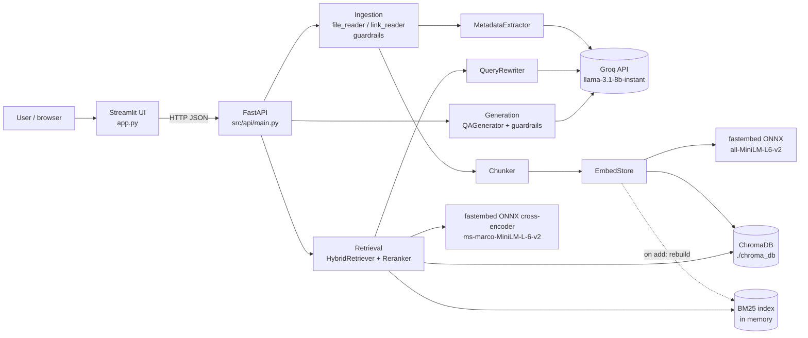
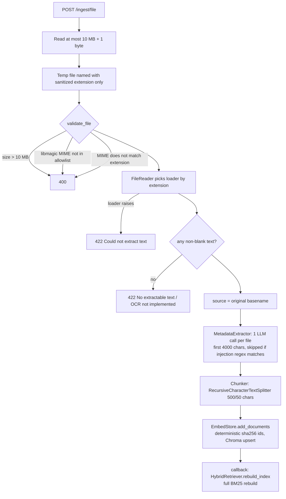

# AnyDoc — Architecture, Design Decisions, and Limitations

This document describes what the code in this repository actually does, verified
against the source and by running it. Parameters are quoted from the code; anything
that is a proposal rather than an implemented feature is labelled **Proposed**.

## 1. What it is

AnyDoc is a document question-answering service. A user uploads files (PDF, DOCX,
TXT, CSV) or submits a URL; the content is split into chunks, embedded and indexed.
Questions are answered by an LLM using only the retrieved chunks, with numbered
citations back to the source chunks.

Two processes, one Docker image:

| Process | Entry point | Role |
|---|---|---|
| API | `src/api/main.py` (FastAPI, run by uvicorn) | Ingestion, retrieval, generation, stats, benchmark |
| UI | `app.py` (Streamlit) | Dashboard; talks to the API over HTTP only (`API_URL`) |

## 2. System diagram



All components are module-level singletons created when `src/api/main.py` is imported
(embedding model loads at startup; the reranker loads lazily on the first query).

## 3. Ingestion flow (upload → storage)



| Input | Loader (actual library) | What you get |
|---|---|---|
| PDF | `PyPDFLoader` (pypdf) | One Document per page, metadata `page` (0-based) and `page_label`. Text layer only: **no OCR**, tables flattened to text, multi-column order is whatever pypdf extracts. Encrypted/corrupt PDFs → 422. Image-only PDFs → 422. |
| DOCX | `Docx2txtLoader` (docx2txt) | One Document with the plain text of the body (tables become text lines; no styles, no page numbers). |
| TXT | `TextLoader` | UTF-8 (BOM stripped), falls back to Latin-1 for legacy files. |
| CSV | `CSVLoader` (stdlib csv) | **One Document per row**, formatted as `header: value` lines; metadata `row`. UTF-8 with Latin-1 fallback. |
| URL | `LinkReader` → `WebBaseLoader` (requests + BeautifulSoup `html.parser`) | See §4. |

Metadata extraction (`src/ingestion/metadata_extractor.py`) adds `extracted_title`,
`extracted_summary`, `extracted_topics`, `document_type` to every chunk. These are stored
in Chroma but **are not embedded and not used by retrieval or the prompt** — they are
informational only. If the Groq call fails, ingestion still succeeds with
"Unknown Title (Extraction Failed)".

## 4. Web ingestion (what it is and is not)

`POST /ingest/url` → `validate_url` → `LinkReader.load(url)`:

1. `resolve_safe_url`: follows up to 5 redirects **manually** (`allow_redirects=False`),
   re-validating every hop (scheme, DNS, IP ranges).
2. robots.txt for the host is fetched through the same validated path and honoured
   (`User-agent: *`). If robots.txt cannot be fetched (network error, 5xx) the page is
   **skipped** (fail-closed).
3. The page is fetched with `WebBaseLoader(raise_for_status=True)`, redirects disabled.
   `soup.get_text()` — script/style text is dropped by BeautifulSoup, but navigation,
   headers and footers are **not** removed (no boilerplate extraction).
4. The primary page's HTML is fetched again and up to **5** `<a href>` links on the
   **same host** (exact `netloc` match, fragments stripped) are loaded the same way.

So it is **single-page ingestion plus depth-1 same-host links (max 5)** — not a
crawler (no recursion, no sitemap, no frontier, no dedupe across runs).
**Not supported:** JavaScript-rendered pages (no headless browser), non-HTML URLs
(a PDF URL is parsed as HTML), authentication, response size limits.

## 5. Query flow (question → answer)

```mermaid
flowchart TD
    Q[POST /query - query 1..2000 chars, not blank] --> R[QueryRewriter: LLM rewrite<br/>skipped if injection regex matches; falls back to original on error]
    R --> S1[Dense: Chroma top-15 using rewritten query]
    R --> S2[BM25: top-15 with score > 0]
    S1 --> F[RRF k=60 → 15 fused candidates]
    S2 --> F
    F --> CE[Cross-encoder rerank on rewritten query → top 5]
    CE --> G{Input guardrails on ORIGINAL query:<br/>injection regex, profanity}
    G -- hit --> RF[Fixed refusal string]
    G --> P[Prompt: numbered 'Document [i] (Source: name)' blocks + original question]
    P --> L[Groq llama-3.1-8b-instant, temperature 0]
    L -- exception --> ERR['An error occurred while generating the answer.' with HTTP 200]
    L --> O{Output guardrails: profanity, citation indices within 1..5}
    O -- fail --> RF2[Fixed refusal string]
    O --> A[answer + sources id/source/page/content/rerank_score + timings]
```

Notes that are easy to get wrong in an interview:

- Retrieval **and reranking** use the rewritten query; the prompt, guardrails and
  citation check use the user's original question.
- Retrieval runs before the input guardrail, so an injected question still costs a
  rewrite-skip + retrieval, then gets the fixed refusal.
- `sources[i]` corresponds exactly to `Document [i]` in the prompt, which is what makes
  `[n]` citations resolvable in the UI.

### Retrieval parameters (from code)

| Parameter | Value | Where |
|---|---|---|
| Chunking | `RecursiveCharacterTextSplitter`, 500 **characters**, 50 overlap | `src/pipeline/chunk.py`, `main.py` |
| Embedding model | `sentence-transformers/all-MiniLM-L6-v2` via fastembed (ONNX) | `src/pipeline/embed_store.py` |
| Embedding dimension | 384, L2-normalized (measured) | — |
| Vector index | Chroma HNSW, space `l2` (measured from collection config) | default; with unit vectors L2 ranking == cosine ranking |
| Collection | `qa_chatbot`, persisted at `./chroma_db` relative to the API's working directory | `main.py` |
| Model-consistency guard | collection metadata `embedding_model_name` checked at startup | `EmbedStore._check_model_consistency` |
| BM25 | `rank_bm25.BM25Okapi` defaults (k1=1.5, b=0.75); lowercase regex tokens that keep `ZX-4471`, `v1.4.2` intact | `src/retrieval/hybrid_search.py` |
| RRF | `score(d) = Σ_lists 1 / (60 + rank)`; documents keyed by (text, chunk_index) | `HybridRetriever._rrf` |
| Candidates | `candidate_n = top_n × 3 = 15` per retriever when a reranker is attached | `HybridRetriever.__init__` |
| Reranker | `Xenova/ms-marco-MiniLM-L-6-v2` (ONNX cross-encoder), raw logits, lazy-loaded | `src/retrieval/reranker.py` |
| Final context | top 5 chunks (~2,500 characters) | `top_n=5` |
| LLM | Groq `llama-3.1-8b-instant`, temperature 0, used for rewrite, metadata, answer | three classes |

## 6. Module responsibilities

| Module | Responsibility |
|---|---|
| `src/api/main.py` | Routes, request validation, temp-file handling, orchestration, timings |
| `src/ingestion/guardrails.py` | SSRF (`validate_url`, `resolve_safe_url`), file validation (size, libmagic MIME, MIME↔extension) |
| `src/ingestion/file_reader.py` | Loader selection by extension, text encoding fallback |
| `src/ingestion/link_reader.py` | Safe URL fetch, robots.txt, depth-1 same-host links |
| `src/ingestion/metadata_extractor.py` | One LLM call per file for title/summary/topics/type |
| `src/pipeline/chunk.py` | Chunking strategies + chunk-quality heuristics (Chunking Lab) |
| `src/pipeline/embed_store.py` | Embeddings, Chroma persistence, idempotent upsert, change callbacks |
| `src/retrieval/hybrid_search.py` | BM25 index, dense search, RRF, optional rerank, run stats |
| `src/retrieval/reranker.py` | Cross-encoder scoring |
| `src/retrieval/query_rewriter.py` | LLM query rewrite with fallback |
| `src/generation/qa_chain.py` | Prompt construction, LLM call, guardrail orchestration |
| `src/generation/guardrails.py` | Injection regex, profanity regex, citation index check |
| `src/evaluation/evaluator.py` | 105-doc dense-vs-hybrid hit-rate benchmark (`/evaluate`) |
| `src/evaluation/demo_retrieval_eval.py` | Recall@K / MRR over `samples/` for 4 retrieval modes |
| `app.py` | Streamlit dashboard: overview, ingestion, chat with traces, chunking lab, evaluation |

## 7. Data and storage

- **ChromaDB** (embedded, on-disk SQLite + HNSW) at `./chroma_db`; Docker Compose mounts
  a named volume there. On Render's free tier there is no disk, so data is lost on restart.
- **BM25** lives only in memory and is rebuilt from Chroma at startup and after every ingest.
- **Model weights** (~175 MB) are downloaded from Hugging Face on first use into
  `%TEMP%\fastembed_cache` (`/tmp/fastembed_cache` on Linux) unless `FASTEMBED_CACHE_PATH`
  is set. Clearing the temp folder forces a re-download.
- **Secrets**: only `GROQ_API_KEY`, read from the environment / `.env` (git- and
  docker-ignored).
- One global collection: every user of a deployment sees and queries the same corpus.

## 8. Technical decisions and trade-offs

| Decision | Why (in this code) | Trade-offs | Alternatives |
|---|---|---|---|
| **RAG** instead of fine-tuning | Answers must come from user-supplied, changing documents with citations | Quality bounded by retrieval; context window limits | Fine-tuning (no citations, stale), long-context stuffing (cost, recall loss) |
| **Recursive character chunking 500/50** | Prefers paragraph → line → word boundaries; small chunks keep MiniLM (≈256-token limit) in range | Characters ≠ tokens; no section awareness; tiny CSV rows become tiny chunks | Token-based, semantic, or layout/heading-aware chunking |
| **all-MiniLM-L6-v2 via fastembed** | Small (384-d), CPU-fast, no PyTorch → fits 512 MB host (README measurements) | Weaker than larger embedders on domain text; English-centric | bge-small/base, e5, OpenAI/Cohere embeddings |
| **ChromaDB embedded** | Zero-ops, persistent, metadata stored alongside vectors | Single process; no multi-tenant isolation; scaling limits | pgvector, Qdrant, Weaviate, OpenSearch |
| **BM25** | Exact tokens (error codes, SKUs, versions) that dense models blur | Full in-memory rebuild per ingest — O(corpus) | Elasticsearch/OpenSearch, SPLADE, Chroma full-text |
| **Hybrid + RRF (k=60)** | Fuses lists with incomparable score scales using ranks only; no tuning | Ignores score magnitude; k=60 is a convention, not tuned here | Weighted score fusion (needs normalization), learned fusion |
| **Cross-encoder rerank** | Joint (query, chunk) scoring improves the final top-5 | ~15 extra model passes per query; adds latency | No rerank, LLM rerank, Cohere Rerank, ColBERT |
| **LLM query rewriting** | Expands vague questions with likely keywords for both retrievers | Extra LLM call per query; can drift/hallucinate terms; reranker also sees rewritten text | HyDE, multi-query, no rewrite |
| **Citation validation** | Cheap check that `[n]` refers to a supplied chunk | Does **not** check that the cited chunk supports the claim | NLI/entailment check, LLM-as-judge, quote extraction |
| **FastAPI** | Typed request models, automatic 422 validation, OpenAPI docs at `/docs` | Sync endpoints run in a threadpool; shared mutable singletons | Flask, Django |
| **Streamlit UI** | Fast to build a dashboard in Python | Server-side reruns; limited UI control | React/Next.js front-end |
| **Docker / Compose / Render** | One image for both services; volume for Chroma; CI runs tests | Model download at runtime (cold start); no healthchecks in Compose | Bake models into the image; Kubernetes |

## 9. Known limitations (current code)

**Documents**
- No OCR: scanned PDFs are rejected with a clear 422.
- PDF tables/columns are flattened by pypdf; no layout analysis.
- Changing a file and re-uploading adds the new chunks but **does not remove the old
  ones** (no delete-by-source). Re-uploading an identical file is idempotent.
- Only `.pdf .docx .txt .csv`; no `.doc`, `.pptx`, `.xlsx`, HTML files, images.

**Web**
- No JavaScript rendering, no boilerplate removal, no response size cap, depth-1 only.
- **DNS rebinding (TOCTOU)**: the hostname is resolved once for validation and again by
  `requests` when connecting; a malicious DNS server can answer differently the second
  time. Proper fix: pin the validated IP for the connection (custom transport) or route
  egress through a filtering proxy. **Not implemented.**

**Generation and safety**
- Prompt-injection defence is a short regex list applied to the user question and the
  metadata preview. **Retrieved chunks are not screened** and the prompt does not mark
  them as untrusted data, so instructions inside a document (see
  `samples/injected_note.txt`) reach the LLM. Behaviour against that is **not verified**.
- Regex guardrails have false positives (e.g. "What is a system prompt?" is refused) and
  are trivially bypassed by rephrasing.
- Citation check validates indices only; an answer with no citations passes.
- If Groq fails (bad key, quota, decommissioned model) `/query` returns HTTP 200 with
  "An error occurred while generating the answer."; rewrite and metadata silently fall back.
- No answer-confidence threshold: a question with no answer still gets 5 chunks and relies
  on the LLM to refuse.

**Service**
- No authentication, rate limiting or tenant isolation; `/evaluate` is an expensive,
  unauthenticated endpoint.
- No structured logging/metrics; timings are returned per request only.

**Evaluation**
- The 105-doc benchmark saturates (8/8 for both modes) — it shows no regression, not
  superiority, and its queries contain the needle IDs verbatim.
- `samples/demo_eval_set.json` is 12 answerable + 3 no-answer queries over 10 chunks.
- Neither benchmark includes query rewriting or measures answer correctness or
  faithfulness end-to-end.

## 10. Scalability bottlenecks and proposed next steps (**Proposed**, not implemented)

1. BM25 full rebuild on every ingest → incremental index or a search engine (OpenSearch).
2. Single embedded Chroma → client/server vector DB with per-tenant collections/filters.
3. Synchronous ingestion inside the request → background job queue (Celery/RQ/Arq) with status polling.
4. Global corpus → auth + per-user/tenant namespaces, metadata filters at query time.
5. Context safety → delimit retrieved text as untrusted data, screen chunks, add an
   output check; evaluate with an injection test set.
6. Grounding → rerank-score threshold for "no answer" (on `samples/` all answerable
   top scores were ≥ −8.85 and all no-answer ≤ −10.97, too small a set to pick a threshold),
   and claim-level citation verification.
7. Evaluation → larger labelled set, end-to-end answer metrics (exact match, faithfulness),
   regression gate in CI.
8. Ops → bake model weights into the image, health/readiness endpoints, structured logs.
