<div class="cover" markdown="0">
<div class="cover-top">AI ENGINEERING · SYSTEM DESIGN · HANDS-ON GUIDE</div>
<div class="cover-title">AnyDoc</div>
<div class="cover-sub">Complete Visual Architecture &amp; Learning Guide</div>
<div class="cover-desc">From zero knowledge to deployment: how a document Q&amp;A system with hybrid retrieval,
cross-encoder reranking, query rewriting and SSRF-hardened ingestion really works,
traced through its actual source code.</div>
<div class="cover-chips"><span class="chip c-user">FastAPI + Streamlit</span><span class="chip c-search">BM25 + vectors + RRF</span><span class="chip c-ai">Cross-encoder + Llama 3.1</span><span class="chip c-store">ChromaDB</span><span class="chip c-sec">SSRF guardrails</span><span class="chip c-infra">Docker · Render</span></div>
<div class="cover-foot">Repository: github.com/Tarunvarma07/AnyDoc_chat · Source of truth: the working tree audited on 10 October 2026<br/>Every implementation claim cites a file and function. Illustrative examples are labelled.</div>
</div>

<div class="toc-page" markdown="0">
<h2 class="toc-title">Contents</h2>
<!--TOC-->
</div>

# How to Use This Guide {#ch0}

This guide teaches the AnyDoc repository from first principles. It assumes you have never met RAG,
embeddings, BM25 or FastAPI. Each chapter adds one idea, then shows where that idea lives in the code.

**Three kinds of statements appear in this guide, and they are always marked:**

<div class="legend-box" markdown="1">

| Marker | Meaning |
|---|---|
| <span class="tag t-real">REAL</span> | Measured or printed by running AnyDoc's own code during the audit (scores, records, timings, screenshots). Reproducible with `docs/guide_src/compute_examples.py` and `capture_screenshots.py`. |
| <span class="tag t-ill">ILLUSTRATIVE</span> | An invented example used to explain an idea (e.g. a 100-page handbook). Not a recorded project output. |
| <span class="tag t-prop">PROPOSED</span> | A possible future improvement. **Not implemented** today. |

</div>

**Colour code used in every diagram:**


**Where things live.** All paths are relative to the repository root. The most important files:

| File | What it does |
|---|---|
| `src/api/main.py` | FastAPI app: all routes, request models, orchestration, timings |
| `src/ingestion/guardrails.py` | SSRF checks (`validate_url`, `resolve_safe_url`) and file checks (`validate_file`) |
| `src/ingestion/file_reader.py` | Picks a loader per file type (PDF, DOCX, TXT, CSV) |
| `src/ingestion/link_reader.py` | Fetches a URL safely, honours robots.txt, follows ≤ 5 same-host links |
| `src/ingestion/metadata_extractor.py` | One LLM call per file for title/summary/topics |
| `src/pipeline/chunk.py` | Chunking + chunk-quality heuristics |
| `src/pipeline/embed_store.py` | Embeddings (fastembed) + ChromaDB storage |
| `src/retrieval/hybrid_search.py` | BM25, dense search, RRF fusion, optional reranking |
| `src/retrieval/reranker.py` | Cross-encoder reranker |
| `src/retrieval/query_rewriter.py` | LLM query rewriting |
| `src/generation/qa_chain.py`, `guardrails.py` | Prompt, LLM call, refusals, citation check |
| `app.py` | Streamlit dashboard (the user interface) |
| `Dockerfile`, `docker-compose.yml`, `render.yaml`, `.github/workflows/ci.yml` | Packaging, CI, deployment |

<div class="callout warn" markdown="1">
**State of the code.** This guide describes the local working tree, which includes audit fixes that are
**not yet committed or pushed**. The live Render deployment builds from GitHub and therefore runs an
older version (see Chapter 22). Live LLM answers were **not** exercised during the audit; every run used
a deliberately invalid key, so screenshots show the error path for generation.
</div>

# 1. Understand AnyDoc in Five Minutes {#ch1}

**The problem.** Organisations keep knowledge in long documents: handbooks, policies, manuals, release
notes, spreadsheets, web pages. Finding one fact means opening files and scrolling, or using Ctrl+F and
hoping you guessed the exact words the author used.

**What AnyDoc does.** You give it documents. It reads them, splits them into small searchable pieces and
indexes them. Then you ask questions in plain English. It finds the pieces most likely to contain the
answer, asks a large language model (LLM) to answer **using only those pieces**, and shows you numbered
citations so you can check the original text.

| You give AnyDoc | You get back |
|---|---|
| PDF (with selectable text), DOCX, TXT, CSV files up to 10 MB | An answer written in plain language |
| A web page URL (plus up to 5 links on the same site) | Numbered sources `[1]…[5]` with file name, page number and excerpt |
| A question typed into the Chat tab | A retrieval trace: the rewritten search query, relevance scores, and timings |

**Who might use it.** A new employee asking about leave rules, a support engineer looking up an error
code, an analyst checking a spreadsheet row. Anyone whose answers are inside documents they own.

**Why it beats manual search.** Ctrl+F needs the exact words. AnyDoc combines *keyword* search (great for
exact codes like `ZX-4471`) with *meaning-based* search (it can match "work from home" to a sentence about
"working remotely"), then re-checks the best candidates with a more careful model.

**What the AI does, and what your data does.** Two different AI models help find text: an *embedding
model* and a *cross-encoder*. A third, the *LLM*, writes the answer. Your documents supply all the facts.
The LLM is instructed to refuse when the documents don't contain the answer.

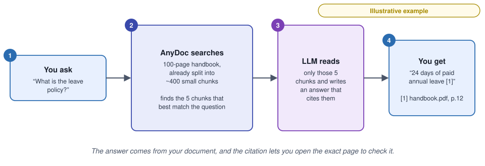{: style="width:80%"}
<p class="caption">Figure 1.1: The idea in four steps. <span class="tag t-ill">ILLUSTRATIVE</span>. No 100-page handbook ships with the repository; <code>samples/acme_handbook.pdf</code> is a small 4-page stand-in.</p>

**How to read it:** follow the numbers left to right. Step 2 is the heart of the system. The LLM in step 3
never sees the whole handbook, only the few chunks retrieval chose. That's why retrieval quality matters
so much.

### What exists today vs what does not

| Implemented and verified | Not implemented |
|---|---|
| PDF (text layer), DOCX, TXT, CSV upload; URL ingestion (page + ≤ 5 same-host links) | OCR for scanned PDFs; JavaScript-rendered sites; recursive crawling |
| Hybrid retrieval: BM25 + dense vectors, fused with RRF | Conversation memory (each question stands alone) |
| Cross-encoder reranking of 15 candidates down to 5 | User accounts, authentication, rate limiting |
| LLM query rewriting, with fallback to the original question | Checking that a cited passage actually supports the claim |
| Guardrails: file type and size, SSRF, prompt-injection regex, citation-index check | Deleting or updating a document once ingested |
| Persistent ChromaDB index on local disk; Docker; CI tests; Render blueprint | Persistent storage on the free Render deployment |

# 2. The Big Picture: What Happens from Start to Finish {#ch2}

AnyDoc has two journeys. **Ingestion** turns files into a searchable index; it happens once per file.
**Question answering** uses that index; it happens on every question.

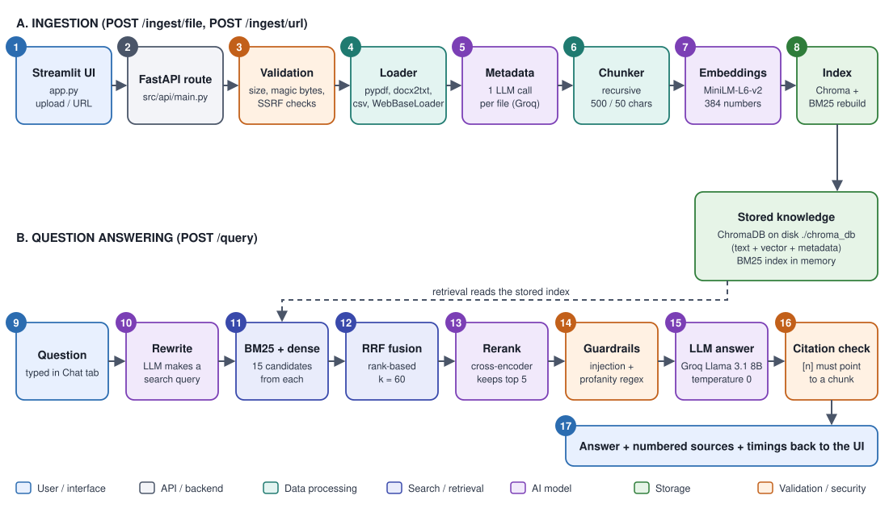
<p class="caption">Figure 2.1: The complete system. Numbers 1–8 are ingestion, 9–17 are question answering. Colours follow the legend.</p>

**How to read it:** read the top row left to right, then follow the arrow down into *Stored knowledge*.
The bottom row starts when a user asks a question; the dashed arrow shows that search (11) reads what
ingestion (8) stored. Purple boxes are the three places where AI models run (embeddings, the
cross-encoder, and the Groq LLM, which is used for metadata, rewriting and answering).

### Stage by stage

<div class="stage-table" markdown="1">

| # | Stage | In → out | Implemented in | Why it exists / what breaks without it | What can go wrong |
|---|---|---|---|---|---|
| 1 | UI | Click / file / text → HTTP request | `app.py` | The human-friendly front door | Backend offline banner; request timeouts (120–170 s) |
| 2 | FastAPI route | HTTP → Python call | `src/api/main.py` (`ingest_file`, `ingest_url`) | Typed contract and validation (422 on bad input) | Unhandled exceptions → 500 |
| 3 | Validation | Raw bytes / URL → accepted or 400 | `validate_file`, `validate_url`, `resolve_safe_url` | Without it: malicious files, SSRF into internal networks | DNS rebinding remains (Ch. 6) |
| 4 | Loader | File → list of `Document(page_content, metadata)` | `FileReader.load`, `LinkReader.load` | Every format becomes one common shape | Scanned PDF → no text (422) |
| 5 | Metadata | Text preview → title, summary, topics, type | `MetadataExtractor.process_documents` | Informational labels; **not used by retrieval** | LLM failure → "Unknown Title (Extraction Failed)", ingestion continues |
| 6 | Chunker | Documents → ≤ 500-character chunks | `Chunker.split_documents` | Precise search, fits model input | Too-small chunks lose context |
| 7 | Embeddings | Chunk text → 384 numbers | `FastEmbedEmbeddings` in `EmbedStore` | Enables meaning-based search | Model download needs internet the first time |
| 8 | Index | Chunks + vectors → Chroma; BM25 rebuilt | `EmbedStore.add_documents`, `HybridRetriever.rebuild_index` | Without it nothing is searchable | Free hosting wipes it on restart (Ch. 22) |
| 9 | Question | Text → `POST /query` | `app.py` → `query_documents` | — | Blank or > 2000 chars → 422 |
| 10 | Rewrite | Question → search query | `QueryRewriter.rewrite` | Adds keywords for both retrievers | LLM down → silently uses original |
| 11 | BM25 + dense | Query → two lists of 15 chunks | `HybridRetriever.get_relevant_documents` | Keyword and meaning matches | Empty index → no sources |
| 12 | RRF | Two ranked lists → one list of 15 | `HybridRetriever._rrf` | Merges incomparable scores fairly | Ignores score margins |
| 13 | Rerank | 15 candidates → best 5 + scores | `Reranker.rerank` | Most precise relevance judgement | First query loads the model (seconds) |
| 14 | Guardrails | Original question → pass or refusal | `check_prompt_injection`, `check_profanity` | Blocks obvious misuse | Regex false positives / bypasses |
| 15 | LLM answer | Prompt (question + 5 chunks) → text | `QAGenerator.generate_answer` | Turns evidence into an answer | Key, quota or model errors |
| 16 | Citation check | Answer → accepted or refused | `verify_citations` | Rejects `[n]` pointing at nothing | Does not check meaning (Ch. 15) |
| 17 | Response | Answer + sources + timings → UI | `query_documents`, `app.py` | Lets users verify the answer | — |

</div>

# 3. Learn the Vocabulary Before the Architecture {#ch3}

Each term builds on the previous ones. Read in order.

<div class="glossary" markdown="1">

| Term | Simple meaning | Analogy | In AnyDoc | Tiny example |
|---|---|---|---|---|
| **API** | A defined way for programs to talk | A restaurant menu: you order from a list | The FastAPI backend | `POST /query` |
| **HTTP** | The language browsers and servers speak | Postal rules for envelopes | UI → API calls via `requests` | `GET /stats` |
| **Endpoint** | One address + method in an API | One item on the menu | 5 endpoints (Ch. 16) | `/ingest/file` |
| **Request / response** | The message sent / the reply | Order slip / plate of food | JSON or multipart in, JSON out | `{"query": "..."}` |
| **JSON** | A text format for structured data | A labelled form | Every response body | `{"answer": "..."}` |
| **Frontend / backend** | What users see / the logic behind it | Dining room / kitchen | Streamlit / FastAPI | Two processes |
| **FastAPI** | Python framework for building APIs | A kitchen with a strict order-checker | `src/api/main.py` | Rejects a blank query with 422 |
| **Loader / parser** | Code that reads a file format | A translator for one language | `PyPDFLoader`, `Docx2txtLoader`, … | PDF → text per page |
| **Web scraping** | Extracting text from a web page | Photocopying an article | `WebBaseLoader` + BeautifulSoup | HTML → plain text |
| **HTML** | The markup language of web pages | The page's skeleton | Parsed by `html.parser` | `<p>Hello</p>` |
| **Document** | LangChain's text + metadata object | An index card | Output of every loader | `Document(page_content, metadata)` |
| **Metadata** | Facts *about* text | The label on a folder | `source`, `page`, `chunk_index`… | `page: 2` |
| **Chunking** | Splitting text into small pieces | Cutting a book into index cards | 500 characters, 50 overlap | 1 page → 1–2 chunks |
| **Token** | A small unit of text a program counts | Syllables | BM25: regex words; models: sub-words | `zx-4471` |
| **Embedding** | A list of numbers capturing meaning | GPS coordinates for meaning | 384 numbers per chunk | `[0.0385, -0.0398, …]` |
| **Vector** | A list of numbers (a point in space) | A map coordinate | Each embedding is a vector | 384 dimensions |
| **Semantic search** | Search by meaning | Asking a librarian | Chroma nearest neighbours | "WFH" finds "remotely" |
| **Keyword search** | Search by shared words | Ctrl+F, but ranked | BM25 | `E1042` |
| **BM25** | A formula ranking keyword matches | Rare words count more | `rank_bm25.BM25Okapi` | Ch. 10 |
| **Vector database** | Stores vectors and finds nearest ones | A map with "closest café" search | ChromaDB | `./chroma_db` |
| **ChromaDB** | An open-source vector database | — | Embedded in the API process | collection `qa_chatbot` |
| **Retrieval** | Finding candidate text | Pulling files from a cabinet | `HybridRetriever` | 15 + 15 candidates |
| **Hybrid retrieval** | Keyword + semantic together | Two librarians compare notes | BM25 + Chroma | Ch. 10 |
| **RRF** | Merging rankings by position | Combining two judges' rankings | `_rrf`, k = 60 | Ch. 11 |
| **Reranking** | Re-scoring a short list carefully | A second, stricter interview | `Reranker` | 15 → 5 |
| **Cross-encoder** | A model reading question + passage together | An examiner reading both at once | `ms-marco-MiniLM-L-6-v2` | Ch. 12 |
| **Query rewriting** | Rephrasing the question for search | Turning a vague request into a search term | `QueryRewriter` | Ch. 13 |
| **LLM** | A model that generates text | A very well-read writer | Groq `llama-3.1-8b-instant` | Ch. 14 |
| **Prompt** | The instructions + data sent to an LLM | A briefing note | `qa_chain.py` template | Ch. 14 |
| **Context window** | How much text an LLM can read at once | Desk space | ~2,500 characters of chunks used | 5 chunks |
| **RAG** | Retrieve evidence, then generate | Open-book exam | The whole system | Ch. 4 |
| **Hallucination** | A confident but unsupported claim | Making up a citation | Reduced by grounding; not eliminated | Ch. 15 |
| **Citation** | A pointer to the evidence used | A footnote | `[1]` → `sources[0]` | Ch. 15 |
| **Guardrail** | A safety check | A bouncer | Regex, SSRF, file checks | Ch. 6 |
| **SSRF** | Tricking a server into fetching internal URLs | Asking a guard to open a staff-only door | `validate_url` | Ch. 6 |
| **Environment variable** | Configuration outside the code | A sticky note on the machine | `GROQ_API_KEY`, `API_URL` | Ch. 19 |
| **Docker / container** | A packaged, isolated runtime | A shipping container | `Dockerfile`, Compose | Ch. 21 |
| **CI/CD** | Automatic test (and deploy) on push | A factory quality check | GitHub Actions runs pytest only | Ch. 21 |
| **Render** | A cloud hosting platform | A rented kitchen | `render.yaml`, 2 free services | Ch. 22 |
| **Persistent storage** | Disk that survives restarts | A safe vs a whiteboard | Compose volume yes; Render free no | Ch. 22 |

</div>

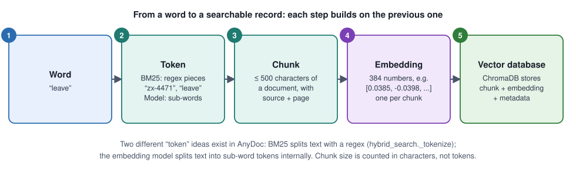
<p class="caption">Figure 3.1: Word, token, chunk, embedding, vector database: five different things.</p>

**How to read it:** left to right, each box is made from the previous one. A *word* is what you type. A
*token* is the unit a program counts: for BM25, AnyDoc's regex keeps `zx-4471` as one token. A *chunk*
is a ≤ 500-character piece of a document. An *embedding* is the 384-number vector computed from one chunk.
The *vector database* stores chunk text, vector and metadata side by side.

# 4. RAG from Zero {#ch4}

**The problem RAG solves.** An LLM learns from public text up to a cut-off date. It has never read *your*
handbook, so if you ask it about your leave policy it can only guess. Training a model on your
documents is slow and expensive, and it has to be redone whenever a document changes.

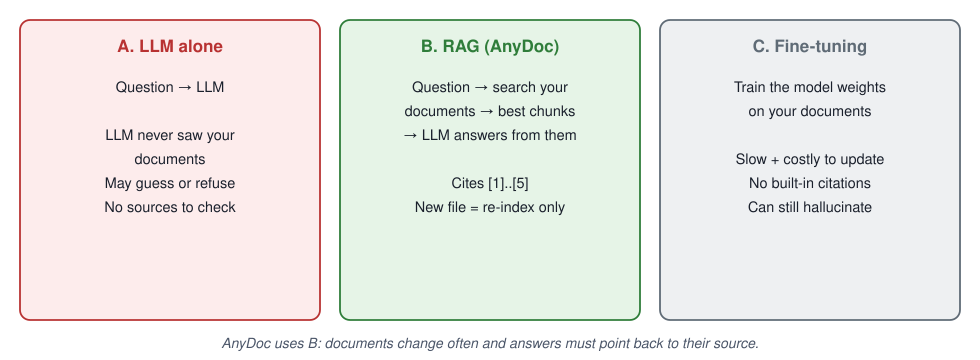
<p class="caption">Figure 4.1: Three ways to answer questions about private documents.</p>

**Why AnyDoc uses RAG (B).** Documents are uploaded at any time and answers must be traceable. With RAG,
adding a document means indexing it in seconds, and every answer can cite its sources. Fine-tuning (C)
changes the model's weights, gives no citations, and still hallucinates. The repository never trains or
fine-tunes any model.

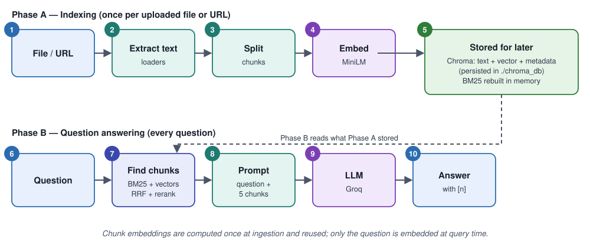
<p class="caption">Figure 4.2: Phase A (indexing) runs once per file; Phase B (question answering) runs per question and reads what Phase A stored.</p>

**How to read it:** the top row is Phase A. Its output (box 5) is stored. The bottom row is Phase B. The
dashed arrow is the only link between the phases: retrieval reads the stored index.

**What is stored, where, and how it is reused** (verified in `src/pipeline/embed_store.py`):

* For every chunk, ChromaDB stores the **text**, its **384-number embedding**, **metadata** (source, page,
  chunk index…) and a deterministic **ID**. It persists to `./chroma_db` (relative to the API's working
  directory).
* Chunk embeddings are computed **once**, during `add_documents`, and reused for every later question.
  At question time only the *question* is embedded.
* The BM25 index is **not** stored on disk. It is rebuilt in memory from all Chroma chunks when the API
  starts and after every ingest (`HybridRetriever.rebuild_index`).
* Re-uploading an identical file does not duplicate anything: IDs are `sha256(source | chunk_index | text)`
  and Chroma *upserts* by ID.

**Retrieving evidence vs generating an answer.** Retrieval only *selects* existing text. It can't invent
anything, but it can pick the wrong chunks. Generation *writes* new text. It can phrase things well, but
it can also misread or embellish the evidence. AnyDoc's design keeps them separate so each can be inspected:
the retrieval trace in the UI shows exactly which chunks the LLM received.

<div class="callout ill" markdown="1">
**One question, end to end** <span class="tag t-ill">ILLUSTRATIVE</span> (uses the real sample corpus). The user asks *"What does error code ZX-4471 mean?"*.
(1) The LLM rewriter may expand it with keywords. (2) BM25 finds the token `zx-4471` in page 3 of
`acme_handbook.pdf`; dense search also ranks that page highly. (3) RRF puts page 3 first. (4) The
cross-encoder scores it **+9.35** <span class="tag t-real">REAL</span> while all others score about −11. (5) The prompt contains
page 3 as `Document [1]`. (6) The LLM should answer that the conveyor safety interlock tripped and cite `[1]`.
(7) `verify_citations` confirms `[1]` exists. (8) The UI shows the answer and "acme_handbook.pdf (p. 3)".
Steps 1, 6 and 7 need a working LLM key and were not run live.
</div>

# 5. File Ingestion: How Each File Type Enters the System {#ch5}

Every upload follows the same gate before the type-specific loader runs.

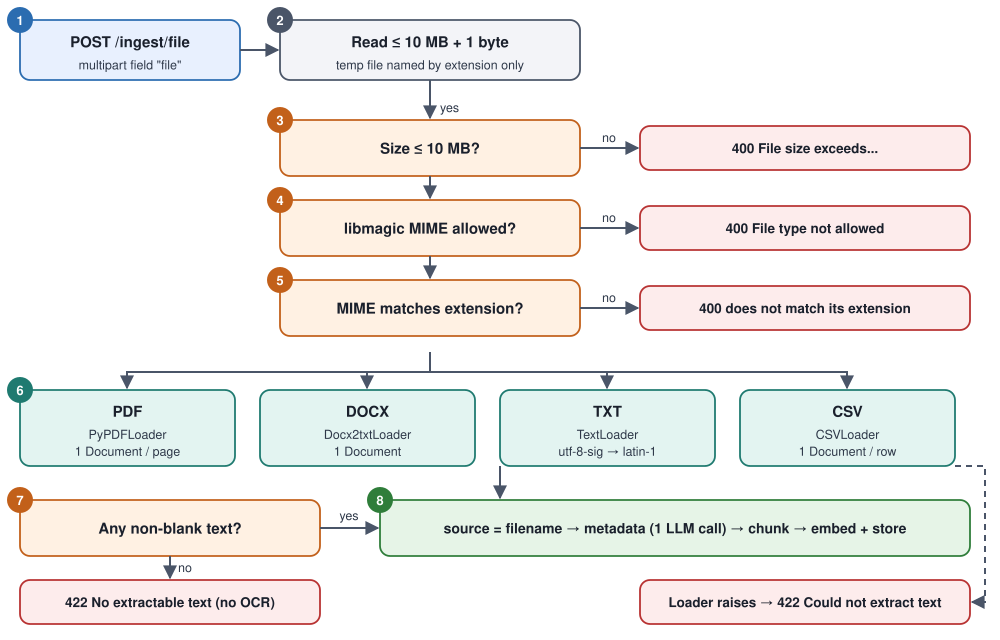
<p class="caption">Figure 5.1: <code>POST /ingest/file</code>, from upload to storage (<code>src/api/main.py: ingest_file</code>).</p>

**How to read it:** top to bottom. Orange boxes are checks; each "no" exits to a red rejection. Only after
all three checks does the extension pick a loader. Box 7 stops files that loaded but contain no text.

Verified details:

* The server reads **at most 10 MB + 1 byte**, so an oversized upload is never held in memory in full.
  (The web framework still receives the full request first; a proxy limit would be needed to stop that.)
* The temporary file is named with the **lower-cased extension only**. An earlier version embedded the
  client's filename, which allowed `../` path traversal on Windows; fixed and covered by a test.
* `validate_file` (`src/ingestion/guardrails.py`) checks, in order: size ≤ 10 MB; the **libmagic** MIME type
  is one of 4 allowed types; and the MIME type matches the extension (`EXTENSION_MIME_TYPES`).
* After loading, `source` metadata is set to the **original filename** (basename only).

### PDF

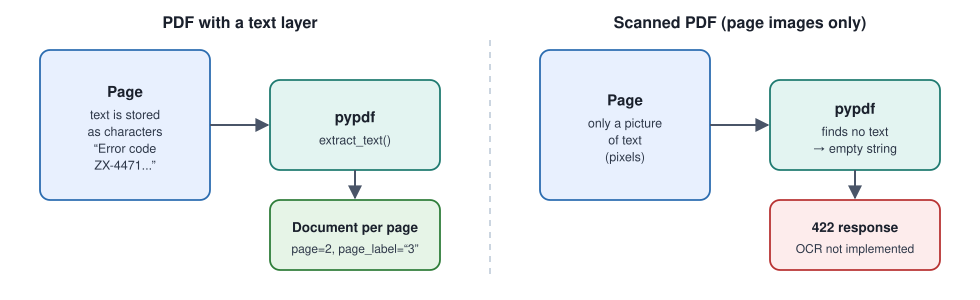
<p class="caption">Figure 5.2: A PDF with a text layer vs a scanned PDF.</p>

A PDF can store text as characters (selectable, searchable) or as a picture of a page (a scan).
`PyPDFLoader` (library **pypdf**) extracts the text layer and returns **one Document per page**, with
`page` (0-based) and `page_label` metadata. The API converts `page` to 1-based in its response, so the UI
shows "p. 3". **No OCR exists.** A scanned PDF yields empty pages, and the API returns
`422 "No extractable text found in the file. Scanned/image-only PDFs are not supported (OCR is not implemented)."`.
Tables and multi-column layouts come out as flat text in whatever order pypdf reads them. Corrupt or
encrypted PDFs → `422 "Could not extract text from '<name>'…"`.

### DOCX

`Docx2txtLoader` (library **docx2txt**) returns **one Document** containing the document's text.
Paragraph breaks survive as newlines; **headings are not marked as headings, and tables become plain lines
of text**. There is no page metadata (DOCX has no fixed pages).

### TXT

`TextLoader` reads the file as **UTF-8** (`utf-8-sig`, which also strips a byte-order mark). If that fails,
it retries as **Latin-1**, which can decode any byte sequence, so legacy Windows-encoded files load instead
of failing (`FileReader._load_text`). Characters specific to other encodings may appear slightly wrong. An
empty file is rejected by libmagic (`inode/x-empty`); a whitespace-only file gets a 422.

### CSV

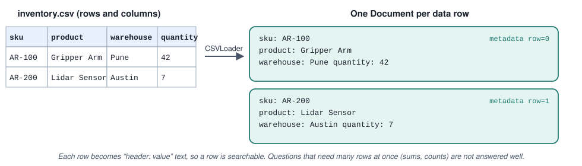
<p class="caption">Figure 5.3: <code>CSVLoader</code> turns each data row into its own Document. <span class="tag t-real">REAL</span> format, from <code>samples/inventory.csv</code>.</p>

The header row supplies field names; each data row becomes a Document whose text is `header: value` lines,
with `row` metadata. This keeps each row's meaning ("quantity: 7" next to "product: Lidar Sensor") and makes
single-row lookups work. **The trade-off:** questions that need many rows at once ("total quantity in
Pune") can't be answered, because retrieval returns 5 chunks, not a table. libmagic usually reports CSV as
`text/plain`, so both `text/csv` and `text/plain` are accepted for `.csv`.

### Web URL

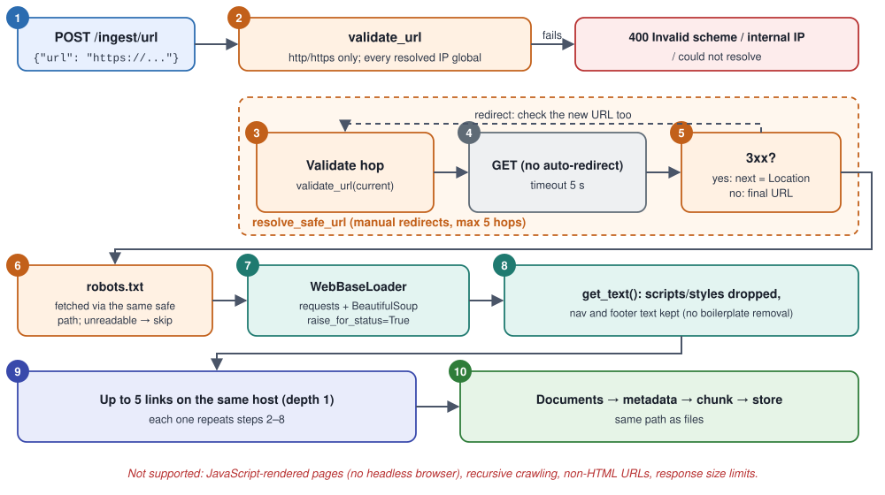
<p class="caption">Figure 5.4: <code>POST /ingest/url</code> (<code>src/ingestion/link_reader.py</code> + <code>guardrails.py</code>).</p>

**How to read it:** the dashed orange region is the redirect loop. Every hop is validated before it is
fetched. Then robots.txt is checked, the page is loaded, and up to 5 same-host links get the same treatment.

The four web capabilities, separated honestly:

| Capability | Supported? | How |
|---|---|---|
| Fetching an HTML page | **Yes** | `requests`, redirects followed manually and validated |
| Extracting readable text | **Partly** | BeautifulSoup `get_text()`: scripts/styles dropped, menus and footers kept |
| Crawling multiple pages | **Depth 1 only** | Up to 5 `<a href>` links on the *same host* found on the first page |
| JavaScript-rendered sites | **No** | No headless browser; content created by JavaScript is never seen |

A web page is not a document like a PDF: it's HTML that may be mostly navigation, and modern sites often
build their text with JavaScript after loading. That's why a news article usually works while a
single-page app may come back nearly empty. If robots.txt can't be read, the page is **skipped**
(fail-closed). HTTP error pages (404/500) are not ingested (`raise_for_status=True`).

# 6. Input Security and Guardrails {#ch6}

A service that fetches URLs and parses uploaded files on its own server has to treat every input as
hostile. AnyDoc has two groups of protections: **ingestion guardrails** (files and URLs) and
**generation guardrails** (questions and answers).

| Protection | Implemented? | Where |
|---|---|---|
| File size limit (10 MB) | Yes | `validate_file`, `main.py` bounded read |
| Real file type from magic bytes (not the extension) | Yes | `validate_file` (libmagic) |
| Spoofed extension (content ≠ extension) | Yes | `EXTENSION_MIME_TYPES` |
| Path traversal via upload filename | Yes | temp suffix = extension only |
| URL scheme must be http/https | Yes | `validate_url` |
| Every resolved IPv4/IPv6 address must be public | Yes | `resolve_all_addresses`, `is_internal_ip` |
| Loopback, private, link-local, CGNAT, multicast, reserved | Yes | `is_internal_ip` (`not is_global or is_multicast`) |
| Cloud metadata (169.254.169.254, 100.100.100.200) | Yes | link-local / shared ranges |
| Redirect hops re-validated (max 5) | Yes | `resolve_safe_url` |
| robots.txt fetch also validated | Yes | `LinkReader._can_fetch` |
| DNS rebinding protection | **No** | — |
| Prompt-injection detection | Regex on the *question* and metadata preview only | `check_prompt_injection` |
| Screening of retrieved document text | **No** | — |
| Citation index check | Yes (index range only) | `verify_citations` |
| Authentication / rate limiting | **No** | — |

### SSRF, properly

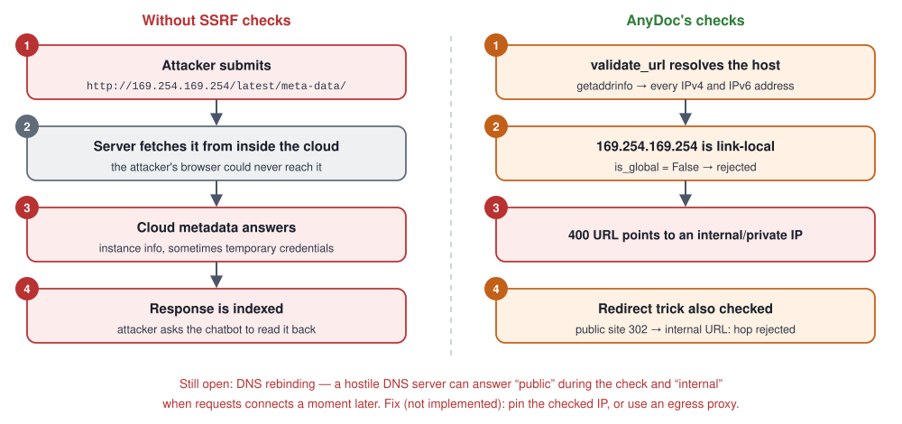
<p class="caption">Figure 6.1: A server-side request forgery attempt, without and with AnyDoc's checks.</p>

**How to read it:** the left column is what happens on an unprotected server; the right column is
AnyDoc's path. Compare step 2 on each side.

**Why it's a server-side problem.** Your browser can't reach `169.254.169.254` (a cloud provider's
internal metadata service) or a company's internal admin panel, but the *server* can, because it sits
inside that network. If the server fetches any URL a user types, the user borrows the server's network
position. AnyDoc's `validate_url`:

```python
addresses = resolve_all_addresses(hostname)          # every A and AAAA record
if not addresses:
    raise SecurityError(f"Could not resolve hostname: {hostname}")
for ip_addr in addresses:
    if is_internal_ip(ip_addr):                      # (not ip.is_global) or ip.is_multicast
        raise SecurityError(f"URL points to an internal/private IP address: {ip_addr}")
```

**Why redirects matter.** A public site can answer with `302 Location: http://169.254.169.254/…`. Normal
HTTP clients follow it automatically, after the first URL already passed validation. `resolve_safe_url`
disables automatic redirects and validates each hop itself. The robots.txt fetch goes through the same path.

**What remains open.** The hostname is resolved once to validate, and again by `requests` when connecting.
A hostile DNS server can return a public IP the first time and an internal IP the second (**DNS
rebinding**). Real protection also needs network-level controls <span class="tag t-prop">PROPOSED</span>: connect to the validated IP
directly, or send all outbound traffic through an egress proxy that blocks internal ranges. **The
application is not perfectly secure, and this guide does not claim otherwise.**

**Prompt injection.** `check_prompt_injection` matches a short regex list ("ignore … previous …
instructions", "system prompt", "you are now", "jailbreak", "bypass … security/rules/…"). It runs on the
user's question (refusal, no LLM call) and on the metadata preview (extraction skipped). It is easy to
rephrase around, and it refuses some legitimate questions ("What is a system prompt?"). **Retrieved chunks
are not screened**: a document containing instructions for the AI (see `samples/injected_note.txt`) reaches
the LLM unchanged.

# 7. Chunking: Why We Split Documents {#ch7}

**Why not give the LLM the whole document?** A long handbook may not fit in the model's input, it costs
more and is slower, and the important sentence gets lost among thousands of others. Retrieval also needs
small units: a single embedding for a whole 100-page file would average everything into mush. So AnyDoc
cuts documents into **chunks** and searches those.

**AnyDoc's actual configuration** (`src/pipeline/chunk.py`, `Chunker(strategy="recursive")` in `main.py`):

```python
RecursiveCharacterTextSplitter(chunk_size=500, chunk_overlap=50, length_function=len)
```

* `length_function=len` means **sizes are counted in characters**, not tokens. 500 characters is roughly
  100–125 English tokens, comfortably within MiniLM's ~256-token input.
* The splitter tries separators in this order (printed from the library): `"\n\n"`, `"\n"`, `" "`, `""`.
  It prefers paragraph breaks, then line breaks, then spaces. **There is no sentence-level separator**, so
  a long paragraph without line breaks is cut at a space, possibly mid-sentence.
* Each chunk keeps the parent document's metadata (`source`, `page`, …) plus `chunk_index` and
  `chunk_strategy`.

### Seeing overlap with a real run

<span class="tag t-real">REAL</span> output of AnyDoc's `Chunker` with a **smaller** size (120 / 30) so the effect fits on a page.
Production uses 500 / 50; the mechanics are identical.

<div class="chunks" markdown="0">
<div class="chunk c1"><div class="chunk-h">Chunk 1 (120 chars)</div>Employees may work remotely up to three days per week. Remote work must be approved by a direct <mark>manager. Full-time staff</mark></div>
<div class="chunk c2"><div class="chunk-h">Chunk 2</div><mark>manager. Full-time staff</mark> receive 24 days of paid annual leave per year. Unused leave can be carried over until March.</div>
<div class="chunk c3"><div class="chunk-h">Chunk 2 if overlap were 0</div>receive 24 days of paid annual leave per year. Unused leave can be carried over until March.</div>
</div>

**How to read it:** the highlighted words appear in both chunks. Chunk 1 was cut mid-sentence (there are
no line breaks to split on). Because of the overlap, chunk 2 still contains the whole sentence *"Full-time
staff receive 24 days…"*. Without overlap (third box) chunk 2 starts with *"receive 24 days…"*: a search for
"how much leave do full-time staff get" has less to match, and an LLM reading only that chunk wouldn't know
who receives the 24 days.

| Chunk size | Effect |
|---|---|
| Too small (e.g. 100) | Precise matches, but facts lose their surrounding context; more chunks to store |
| Too large (e.g. 3,000) | Each chunk mixes topics; its embedding becomes vague; fewer distinct facts fit in 5 chunks |
| AnyDoc: 500 / 50 | A reasonable default. **Not tuned** against an evaluation set (a sweep is <span class="tag t-prop">PROPOSED</span>) |

**Why this splitter?** The README says the recursive splitter was chosen to avoid mid-sentence cuts and
fragments. The Chunking Lab tab compares it with `CharacterTextSplitter("\n\n")` on any text you paste.
As shown above, it reduces but does not eliminate mid-sentence cuts.

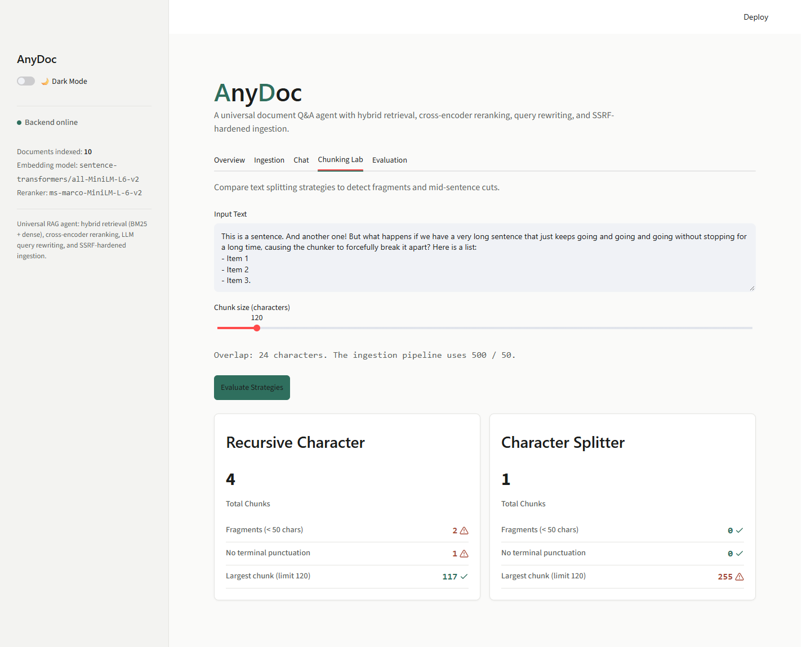
<p class="caption">Figure 7.1: The Chunking Lab tab <span class="tag t-real">REAL</span> at size 120. The character splitter reports zero fragments only because it couldn't split at all: its single chunk is 255 characters, over the 120 limit ("Largest chunk" row).</p>

# 8. Embeddings: Turning Meaning into Numbers {#ch8}

An **embedding model** reads a piece of text and outputs a fixed-length list of numbers (a **vector**).
The model was trained so that texts used in similar ways end up with similar numbers. It doesn't
"understand" like a person; it has learned statistical patterns that place related phrases near each other.

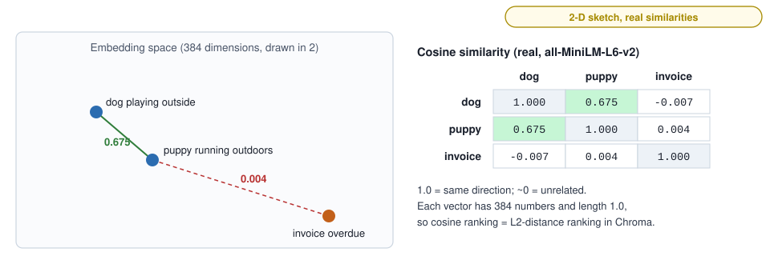
<p class="caption">Figure 8.1: Similar meanings, nearby vectors. The 2-D positions are a sketch; the similarity numbers are <span class="tag t-real">REAL</span> outputs of AnyDoc's embedding model.</p>

**How to read it:** the table is the evidence. "The dog is playing outside" and "A puppy is running
outdoors" share no important words, yet their cosine similarity is **0.675**. Either sentence against "The
quarterly invoice is overdue" is about **0**. Cosine similarity measures how closely two vectors point in
the same direction (1 = identical, 0 = unrelated).

**AnyDoc's embedding setup** (`src/pipeline/embed_store.py`):

```python
FastEmbedEmbeddings(model_name="sentence-transformers/all-MiniLM-L6-v2")
```

* Library: **fastembed** (ONNX runtime), wrapped by LangChain's `FastEmbedEmbeddings`. No PyTorch: the
  README documents that the PyTorch version ran out of memory on a 512 MB host.
* Output: **384 numbers per text**, **unit length** (measured: norm 1.0). First values for "The dog is playing
  outside": `[0.0385, -0.0398, 0.0708, 0.0278, -0.0069, …]` <span class="tag t-real">REAL</span>.
* **Chunks** are embedded once at ingestion; each **question** is embedded at query time so it can be
  compared with the stored chunk vectors.
* **Consistency guard:** the collection records `embedding_model_name`. If the API starts with a different
  model, `_check_model_consistency` raises *"Embedding model mismatch!"*, because vectors from two different
  models live in different spaces and comparing them is meaningless.

**Embeddings vs the LLM.** The embedding model only turns text into numbers for searching; it never writes
words. The LLM (Groq Llama 3.1 8B) writes the answer and never sees vectors. They are separate models with
separate jobs.

# 9. ChromaDB: Where Searchable Knowledge Lives {#ch9}

ChromaDB is a **database**, not an AI. It stores records and, given a query vector, returns the records
whose vectors are nearest. AnyDoc uses it **embedded** inside the API process through LangChain's `Chroma` wrapper.

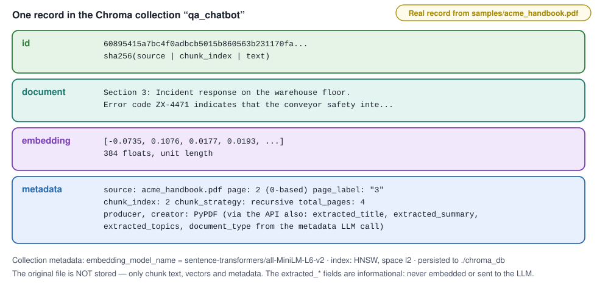
<p class="caption">Figure 9.1: A <span class="tag t-real">REAL</span> record, read back from Chroma after ingesting <code>samples/acme_handbook.pdf</code> with AnyDoc's code.</p>

**How to read it:** one record = one chunk. The four bands are what Chroma keeps. Note the `page: 2`
(0-based) with `page_label: "3"`: the UI shows "p. 3".

| Question | Verified answer |
|---|---|
| How are chunks added? | `EmbedStore.add_documents(chunks)` → embeds them via fastembed → upserts with deterministic IDs |
| How are embeddings related to records? | One 384-number vector per record, computed from the record's text |
| How does similarity search work? | `as_retriever(search_kwargs={"k": 15}).invoke(query)` embeds the query and asks the HNSW index for the 15 nearest vectors (space `l2`; on unit vectors this ranks the same as cosine) |
| Does data persist? | Yes on a normal disk: `persist_directory="./chroma_db"`, relative to the API's working directory |
| Empty database? | Retrieval returns nothing; the answer is *"I did not find any relevant information to answer your question."* |
| Is the original file stored? | **No.** Only chunk text, vectors and metadata. The uploaded temp file is deleted after ingestion |
| Docker Compose | `chroma_data` volume mounted at `/app/chroma_db`: survives container restarts |
| Render (free) | No persistent disk: the index is lost on restart, redeploy or spin-down (Ch. 22) |

# 10. Search Methods: Dense Retrieval vs BM25 {#ch10}

We'll use one tiny corpus and one question throughout, and run them through **AnyDoc's actual code**.

| Doc | Text |
|---|---|
| A | The payment gateway returned error code E1042. |
| B | The checkout process failed because the bank service was unavailable. |
| C | The employee leave policy allows 18 annual leave days. |

Question: **"What happened to payment error E1042?"**

### Keyword search and BM25

Keyword search ranks documents by shared words. **BM25** is the standard formula for that ranking. For each
query word found in a document it adds a score that grows with:

* **Term frequency**: how often the word occurs in the document, with diminishing returns (parameter `k1 = 1.5`).
* **Rarity**: words found in few documents (high IDF) count more than common words like "the".
* **Length normalisation**: a match in a short document counts more than one in a long document (`b = 0.75`).

AnyDoc uses `rank_bm25.BM25Okapi` with those defaults. Text is tokenised by `HybridRetriever._tokenize`:

```python
_TOKEN_PATTERN = re.compile(r"\w+(?:[-.]\w+)*")   # keeps "e1042", "zx-4471", "v1.4.2" whole
return _TOKEN_PATTERN.findall(text.lower())
```

The question becomes `what, happened, to, payment, error, e1042`. An earlier version split on whitespace,
which produced `e1042?` (with the question mark) and never matched the document. The audit found and fixed
this; on the sample evaluation, BM25's MRR rose from 0.68 to 0.89.

### Dense (vector) search

The question and every chunk are embedded; Chroma returns the chunks whose vectors are closest to the
question's vector. Words don't have to match: closeness of meaning is enough.

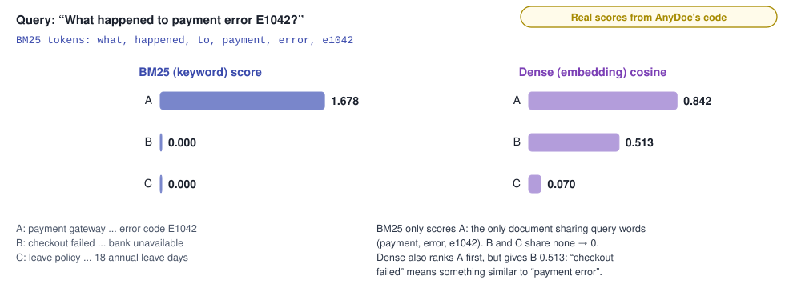
<p class="caption">Figure 10.1: <span class="tag t-real">REAL</span> BM25 scores and cosine similarities for the example, computed with AnyDoc's tokenizer, BM25 class and embedding model.</p>

**How to read it:** left bars are BM25, right bars are dense similarity. BM25 sees only exact shared tokens,
so B and C get exactly 0. Dense search also prefers A but rates B (a failed checkout, related to payments)
far above C (leave policy).

| | BM25 (keyword) | Dense (embedding) |
|---|---|---|
| Strengths | Exact IDs, error codes, version numbers, names, rare terms | Synonyms, paraphrases, questions worded differently from the text |
| Weaknesses | Misses synonyms ("WFH" vs "remotely"); depends on tokenisation | Can blur rare identifiers; a "similar-sounding" passage can outrank the right one |
| In AnyDoc | `BM25Okapi`, in memory, top 15 with score > 0 | Chroma HNSW, top 15 nearest |

### Hybrid retrieval in AnyDoc

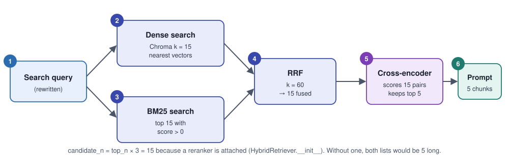
<p class="caption">Figure 10.2: <code>HybridRetriever.get_relevant_documents</code>, with the real candidate counts.</p>

**How to read it:** the query fans out to both searches (2, 3), RRF merges them (4), the cross-encoder
picks the final 5 (5), and those go into the prompt (6).

Verified behaviour (`src/retrieval/hybrid_search.py`):

* `candidate_n = top_n × 3 = 15` because a reranker is attached; without one it would be 5.
* BM25 keeps only documents with score > 0 (top 15). Dense always returns up to 15.
* RRF keys documents by (text, chunk_index), so the same chunk found by both searches is merged, not duplicated.
* The fused list is cut to 15, reranked, and the top 5 returned. `last_run_stats` records
  `candidates_considered`, `reranked`, `elapsed_ms`.
* If BM25 finds nothing, RRF simply uses the dense list. If the index is empty, retrieval returns an empty
  list immediately. There is no special handling if Chroma itself raises; that would surface as an HTTP 500.

**Does hybrid always win?** No. On the project's 105-document benchmark, dense-only and hybrid both scored
8/8. On the 12-query demo set, hybrid had a higher MRR than dense (0.92 vs 0.88) but the same Hit@3. Hybrid
widens coverage; it is not guaranteed to improve every query (Ch. 20).

# 11. Reciprocal Rank Fusion (RRF) {#ch11}

BM25 scores (like 1.678) and vector distances live on different scales. Adding them is like adding metres
to kilograms. **RRF ignores the raw scores and uses only rank positions.**

**Formula:** for each document, add up `1 / (k + rank)` over every list in which it appears.

* `rank`: position in that list (1 = top).
* `k`: a constant (AnyDoc: **60**, `HybridRetriever(k=60)`). It controls how much the very top positions
  dominate. With k = 60, rank 1 is worth 1/61 = 0.0164 and rank 10 is worth 1/70 = 0.0143: being found
  at all matters a lot; being #1 rather than #10 matters only a little.
* A document missing from a list gets nothing from that list.

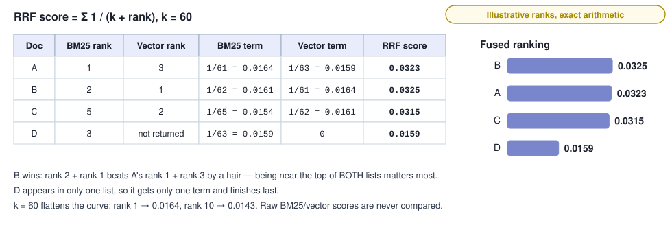
<p class="caption">Figure 11.1: Worked example. Ranks are <span class="tag t-ill">ILLUSTRATIVE</span>; the arithmetic is exact.</p>

**How to read it:** each row adds two terms. B (ranks 2 and 1) narrowly beats A (ranks 1 and 3); D,
found by only one search, comes last.

AnyDoc's implementation, verbatim:

```python
for rank, doc in enumerate(dense_results, start=1):
    key = doc_key(doc)                       # (page_content, chunk_index)
    rrf_scores[key] = rrf_scores.get(key, 0.0) + 1.0 / (self.k + rank)
    doc_map[key] = doc
for rank, doc in enumerate(sparse_results, start=1):
    ...same accumulation for the BM25 list...
sorted_keys = sorted(rrf_scores.keys(), key=lambda x: rrf_scores[x], reverse=True)
```

**Why RRF here, honestly:** no score normalisation, no weights to tune, robust to one retriever having
extreme scores. The cost is that it ignores *how much* better one result is than another. A tuned weighted
combination can beat it when labelled data exists. k = 60 is the conventional value from the original
paper (Cormack et al., 2009), **not tuned** for this project.

# 12. Reranking: Choosing the Best Evidence {#ch12}

| Stage | Purpose | In AnyDoc |
|---|---|---|
| Initial retrieval | Cheap, broad search over every chunk | BM25 + dense, 15 each |
| Candidate generation | One merged shortlist | RRF → 15 |
| Reranking | Expensive, careful scoring of the shortlist | Cross-encoder → scores |
| Final context selection | What the LLM will read | Top 5 by rerank score |

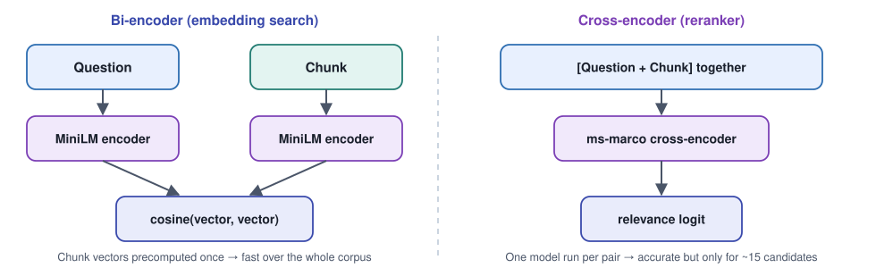
<p class="caption">Figure 12.1: A bi-encoder (embedding search) encodes question and chunk separately; a cross-encoder reads them together.</p>

1. **What a cross-encoder receives:** the question and one passage, joined into a single input.
2. **How it compares them:** every word of the question can attend to every word of the passage inside
   the model, so it notices exact relationships ("hotel" ↔ "accommodation", "per night" ↔ "nightly").
3. **Why it can disagree with embedding search:** the bi-encoder compressed each text into one vector
   *before* seeing the question; the cross-encoder judges the pair directly.
4. **Why it costs more:** one model run per (question, passage) pair, at query time. Nothing can be
   precomputed.
5. **Why initial retrieval is still needed:** running the cross-encoder over every chunk of a large corpus
   on every question would be far too slow.

AnyDoc: `Reranker(model_name="Xenova/ms-marco-MiniLM-L-6-v2")` via fastembed's `TextCrossEncoder`,
**lazy-loaded** on the first query (so the first question is slower). Scores are raw **logits** stored as
`rerank_score`; higher means more relevant.

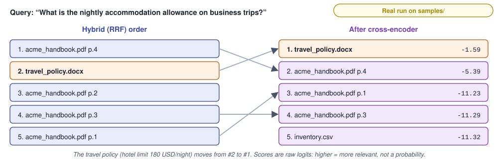
<p class="caption">Figure 12.2: <span class="tag t-real">REAL</span> run over the 10 sample chunks. The cross-encoder moved the travel policy (the only text mentioning hotel limits) to #1, and pulled <code>inventory.csv</code> in from outside the hybrid top 5, because it scores all candidates.</p>

**A relevance score is not proof.** A high score means "this passage looks related to the question", not
"this passage contains a correct answer". In the run above, the #2 chunk (expenses) scored −5.39: related
to travel spending, but it does not contain the hotel limit.

# 13. Query Rewriting {#ch13}

Users type short, vague or abbreviated questions. Before retrieval, AnyDoc asks the LLM to rewrite the
question into a single retrieval-friendly search query (`src/retrieval/query_rewriter.py`).

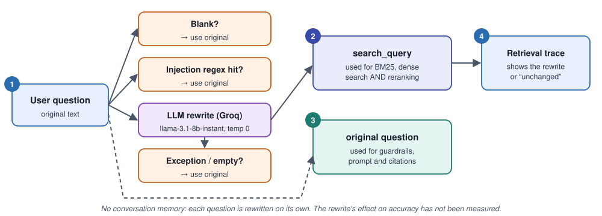
<p class="caption">Figure 13.1: Where the rewritten and the original question go.</p>

**How to read it:** the rewrite feeds search and reranking (box 2). The original question goes to the
guardrails, the prompt and the citation check (box 3). Three conditions fall back to the original.

Verified details:

* Model: Groq `llama-3.1-8b-instant`, temperature 0. The prompt's rules: preserve meaning, never answer,
  resolve vague references *using context already in the question*, add likely keyword variants (error
  codes, versions, IDs) without inventing facts, output one line.
* Fallbacks to the original question: blank input; a prompt-injection regex match; any exception (bad key,
  network, quota); an empty result. Surrounding quotes are stripped.
* **No conversation memory.** "What about its price?" can't be resolved, because no previous turn is
  sent. Each question is rewritten on its own.
* The UI's retrieval trace shows the rewritten query, or "(unchanged from original)" when it fell back.

<div class="callout ill" markdown="1">
<span class="tag t-ill">ILLUSTRATIVE</span> **Before:** `zx4471 meaning?` → **After (the kind of output the prompt asks for):** `ZX-4471 error code meaning`.
Not a recorded output: rewriting needs a live LLM, which was not run during the audit. The effect of
rewriting on retrieval quality has **not been measured**; neither benchmark includes it.
</div>

# 14. LLM Generation: How the Final Answer Is Produced {#ch14}

Only now, with 5 chunks selected, does the answer-writing model run (`src/generation/qa_chain.py`).

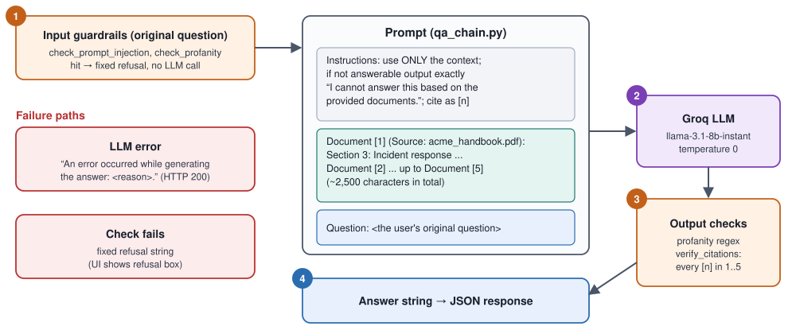{: style="width:68%"}
<p class="caption">Figure 14.1: Input guardrails → prompt → Groq LLM → output checks → response.</p>

The real prompt template (abridged only where marked):

```text
You are an expert Q&A assistant. Your goal is to answer the user's question based
strictly on the provided context documents.
Guidelines:
1. You must ONLY use the provided context to answer the question. ...
2. If the context does not contain the answer, your ENTIRE output must be EXACTLY
   "I cannot answer this based on the provided documents." ...
3. You must cite your sources using the document index number in brackets, e.g., [1] or [3]. ...
4. STRICT GROUNDING: Only state a fact if the document EXPLICITLY states it. ...
Context Documents:
Document [1] (Source: acme_handbook.pdf):
<chunk text>
...
Question:
<the user's original question>
Answer:
```

| Topic | What the code does |
|---|---|
| Inputs | Original question + 5 chunks formatted as `Document [i] (Source: name)`. No system/user role split; one prompt string |
| Context size | ~5 × 500 = 2,500 characters: far below the model's context window |
| Grounding | Instructions only. Nothing forces the model to comply |
| Unsupported questions | The model should output the exact refusal sentence; the UI shows it in a refusal box |
| No chunks found | Fixed message: "I did not find any relevant information to answer your question." (no LLM call) |
| Model errors | "An error occurred while generating the answer: <reason>." with HTTP 200 |
| Provider / settings | Groq API, `llama-3.1-8b-instant`, temperature 0, no streaming |

**Why evidence doesn't guarantee correctness.** The model can misread a chunk, combine two chunks wrongly,
or ignore the refusal rule. Grounding *reduces* hallucination risk; it doesn't remove it, and the project
has no measurement of how often it happens.

<div class="callout ill" markdown="1">
<span class="tag t-ill">ILLUSTRATIVE</span> **Question:** "How many days per week can I work remotely?" → **Retrieved:** `Document [1]`: handbook p.1 *"Employees may work remotely up to three days per week…"*
→ **Expected answer:** "Employees may work remotely up to three days per week, with manager approval [1]."
→ `verify_citations` sees `[1]`, which is between 1 and 5, so the answer passes → the UI shows it with source "acme_handbook.pdf (p. 1)".
</div>

# 15. Citations and Reliability {#ch15}

A citation lets the reader verify a claim. In AnyDoc, `[n]` in the answer refers to `Document [n]` in the
prompt, which is exactly `sources[n-1]` in the API response. That alignment comes from building both lists
from the same `retrieved_docs` in the same order.

Simplified from `src/generation/guardrails.py: verify_citations` (logging and a `ValueError` guard omitted):

```python
citations = re.findall(r'\[(\d+)\]', answer)
for cit in citations:
    if int(cit) > len(context_docs) or int(cit) < 1:
        return False        # -> "The generated answer failed verification (Hallucinated Citations)."
return True                 # also True when there are no citations at all
```

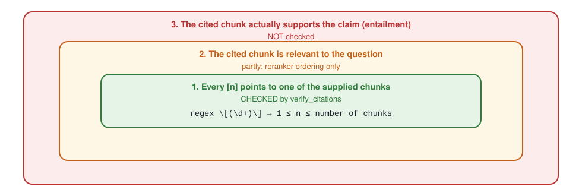
<p class="caption">Figure 15.1: Three levels of citation quality; only the innermost is checked.</p>

| Level | Meaning | Checked? |
|---|---|---|
| Valid identifier | `[3]` refers to a chunk that was supplied | **Yes**, `verify_citations` |
| Relevant source | The cited chunk is about the question | Indirectly: the reranker ranked it highly |
| Supports the claim | The chunk actually states what the sentence says | **No** |

Gaps to know: an answer with **no citations passes**; `[1, 2]`-style citations are not parsed; a number
in brackets inside code (`array[10]`) could be misread. Future improvements <span class="tag t-prop">PROPOSED</span>: an entailment
(NLI) check per cited sentence, quote extraction, or an LLM judge, all measured on a labelled
faithfulness set.

# 16. Complete API Reference and Request/Response Flow {#ch16}

The FastAPI app (`app = FastAPI(title="Universal Q&A Pipeline API")` in `src/api/main.py`) registers
**five routes**. FastAPI also serves interactive documentation automatically:

* Swagger UI: `http://localhost:8000/docs` · ReDoc: `http://localhost:8000/redoc` · schema: `/openapi.json`

| Method | Path | Purpose | Called by |
|---|---|---|---|
| GET | `/stats` | Corpus size and pipeline settings; also Render's health check | UI sidebar, Overview, Ingestion tabs |
| POST | `/ingest/file` | Upload and index one file | UI Ingestion tab |
| POST | `/ingest/url` | Fetch and index a web page (+ ≤ 5 links) | UI Ingestion tab |
| POST | `/query` | Ask a question | UI Chat tab |
| POST | `/evaluate` | Run the 105-document retrieval benchmark | UI Evaluation tab ("Re-run live") |

There is no authentication, no request ID, and no rate limiting. The UI calls the API with `requests`
(timeouts: `/stats` 45 s, `/ingest/url` 120 s, `/ingest/file` and `/query` 170 s).

### GET /stats

```http
GET /stats HTTP/1.1
```

```json
{"document_count": 10, "embedding_model": "sentence-transformers/all-MiniLM-L6-v2",
 "reranker_model": "Xenova/ms-marco-MiniLM-L-6-v2", "reranker_enabled": true, "hybrid_k": 60, "top_n": 5}
```

<span class="tag t-real">REAL</span> response after ingesting the 4 sample files. `document_count` counts **chunks**, not files.
Practical test: `curl http://localhost:8000/stats`

### POST /ingest/file

**Why multipart?** A file is binary. JSON can only carry text, so binary would have to be re-encoded
(and grow by ~33%). HTTP `multipart/form-data` sends the raw bytes as a named part. The part must be named
**`file`** (`file: UploadFile = File(...)`).

```http
POST /ingest/file HTTP/1.1
Content-Type: multipart/form-data; boundary=----X

------X
Content-Disposition: form-data; name="file"; filename="acme_handbook.pdf"
Content-Type: application/pdf

%PDF-1.4 ...binary...
------X--
```

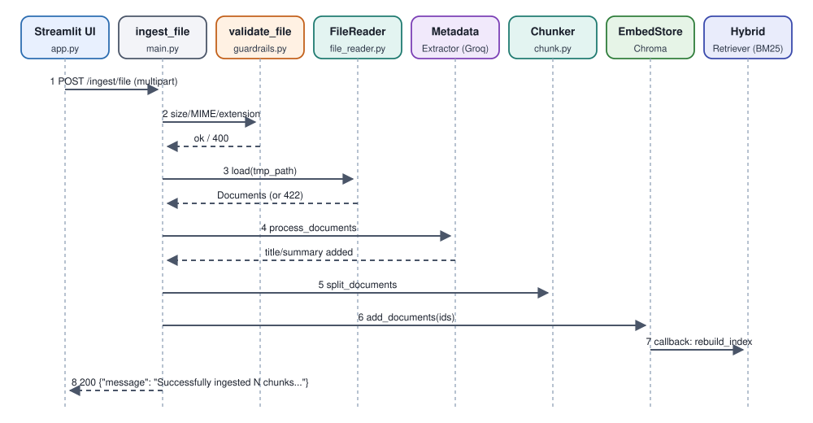{: style="width:82%"}
<p class="caption">Figure 16.1: Internal sequence for <code>/ingest/file</code>.</p>

| Status | Body (`detail` or `message`) | When |
|---|---|---|
| 200 | `{"message": "Successfully ingested 4 chunks from file."}` | Success (<span class="tag t-real">REAL</span>, handbook) |
| 400 | `File size (… bytes) exceeds maximum allowed size (10 MB).` | > 10 MB |
| 400 | `File type not allowed: text/html. Allowed types: …` | e.g. `samples/invoice.pdf` |
| 400 | `File content (application/pdf) does not match its extension ('.txt').` | Renamed file |
| 400 | `Unsupported file extension: '.md'. Allowed: .pdf, .docx, .txt, .csv` | Allowed MIME, unsupported extension |
| 422 | `Could not extract text from '<name>'. The file may be corrupt, encrypted, or malformed.` | Loader error |
| 422 | `No extractable text found in the file. …(OCR is not implemented).` | Scanned PDF, blank TXT |
| 422 | FastAPI validation list (`"loc": ["body","file"], "type": "missing"`) | No `file` part |

```bash
curl -F "file=@samples/acme_handbook.pdf" http://localhost:8000/ingest/file
```

### POST /ingest/url

```json
{"url": "https://example.com/article"}
```

`url` is a string of at most 2,048 characters. Responses: `200 {"message": "Successfully ingested N chunks from URL."}`;
`400` for a bad scheme, unresolvable host or internal address (`"URL points to an internal/private IP address: 169.254.169.254"`);
`400 "Failed to read content from URL."` if nothing could be loaded (including robots.txt blocks and HTTP errors);
`422` if the page had no text.

```bash
curl -X POST http://localhost:8000/ingest/url -H "Content-Type: application/json" \
     -d '{"url": "http://169.254.169.254/latest/meta-data/"}'      # -> 400, SSRF blocked
```

### POST /query

```json
{"query": "What does error code ZX-4471 mean?"}
```

`query`: 1–2,000 characters, not blank, otherwise 422 (`"type": "string_too_short"`, `"loc": ["body","query"]`).

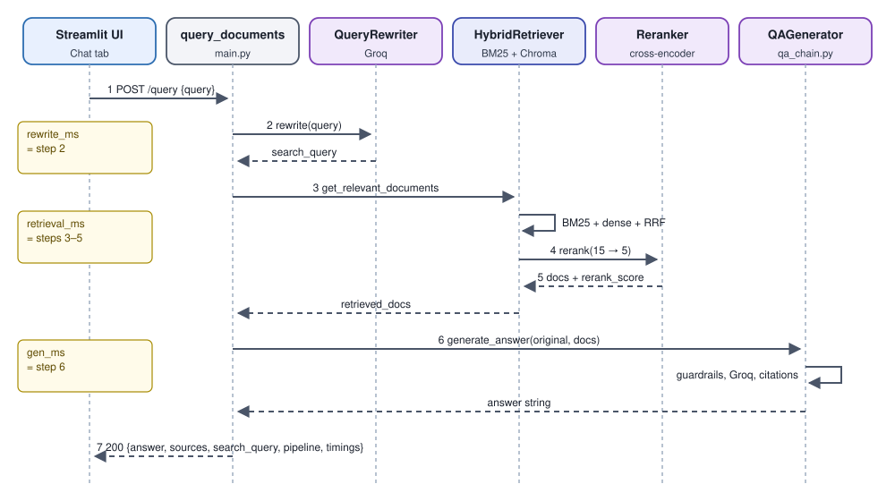{: style="width:82%"}
<p class="caption">Figure 16.2: Internal sequence for <code>/query</code>, with what each timing field covers.</p>

Response shape. Sources, candidate count and timings are <span class="tag t-real">REAL</span> (offline run, timings rounded as the UI displays them); the `answer` is <span class="tag t-ill">ILLUSTRATIVE</span> because no live LLM was used, and `elapsed_ms` was not recorded:

```text
{
  "answer": "Error code ZX-4471 indicates that the conveyor safety interlock tripped [1].",
  "sources": [
    {"id": 1, "source": "acme_handbook.pdf", "page": 3,
     "content": "Section 3: Incident response on the warehouse floor.\nError code ZX-4471 indicates ...",
     "rerank_score": 9.35},
    {"id": 2, "source": "inventory.csv", "page": null, "content": "sku: AR-300\n...", "rerank_score": -11.17}
  ],
  "search_query": "What does error code ZX-4471 mean?",
  "pipeline": {"candidates_considered": 10, "reranked": true, "elapsed_ms": <float, close to retrieval_ms>},
  "timings": {"rewrite_ms": 98, "retrieval_ms": 734, "gen_ms": 101}
}
```

| Field | Meaning (verified in `query_documents`) |
|---|---|
| `answer` | Final string: model answer, refusal, or error sentence |
| `sources[i]` | The chunk shown to the LLM as `Document [i+1]`; `content` is the first 200 characters; `page` is 1-based (PDF only) |
| `search_query` | Output of the rewriter (equals the question when it fell back) |
| `pipeline` | `HybridRetriever.last_run_stats`. Quirk: not refreshed when the index is empty, so it can show the previous query's values |
| `rewrite_ms` | Wall-clock (`time.time`) around `query_rewriter.rewrite` |
| `retrieval_ms` | Wall-clock around `get_relevant_documents`: query embedding, Chroma, BM25, RRF and reranking (includes loading the cross-encoder on the first query) |
| `gen_ms` | Wall-clock around `generate_answer`: guardrails, prompt, the Groq round trip, output checks |

```bash
curl -X POST http://localhost:8000/query -H "Content-Type: application/json" \
     -d '{"query": "What does error code ZX-4471 mean?"}'
```

PowerShell equivalent: `Invoke-RestMethod -Method Post -Uri http://localhost:8000/query -ContentType "application/json" -Body '{"query":"What does error code ZX-4471 mean?"}'`

### POST /evaluate

No body. Builds the 105-document benchmark in a temporary Chroma collection, reusing the loaded embedding
model, and returns `{"total_queries": 8, "dense_hit_rate": 1.0, "hybrid_hit_rate": 1.0}` (<span class="tag t-real">REAL</span>). It is
expensive (~350 MB documented in DEPLOY.md) and unauthenticated. The UI shows the committed result by
default and only calls this endpoint when you expand "Re-run live".

**Observability.** There is no request ID and no metrics endpoint. Errors go to the uvicorn console via
Python logging (e.g. `LLM Generation failed: …`, `Security error while validating …`). Per-request timings
are returned in `/query` and shown in the UI trace.

# 17. Trace One Real Request Through the Code {#ch17}

Question: **"What does error code ZX-4471 mean?"**, asked against the four sample files. Values marked
<span class="tag t-real">REAL</span> were observed in the audit run; the LLM steps used an invalid key and are described, not shown.

| # | What happens | File / function | Input → output |
|---|---|---|---|
| 1 | Request enters the API | `main.py: query_documents` | JSON body → `QueryRequest(query=...)` |
| 2 | Input validated | Pydantic `Field(min_length=1, max_length=2000)` + `query_not_blank` | valid → continue; blank → 422 |
| 3 | Query rewritten | `QueryRewriter.rewrite` | Live: an LLM rewrite. In the audit run: fallback → original (`rewrite_ms` 98 <span class="tag t-real">REAL</span>) |
| 4 | Query tokenised | `HybridRetriever._tokenize` | `what, does, error, code, zx-4471, mean` |
| 5 | BM25 ranking | `bm25.get_scores` | Handbook page 3 (contains `zx-4471` twice) ranks first |
| 6 | Dense ranking | `as_retriever(k=15).invoke` | Up to 15 nearest chunks by embedding |
| 7 | RRF fusion | `_rrf(dense, sparse, top_n=15)` | 10 fused candidates (corpus has only 10 chunks) <span class="tag t-real">REAL</span> |
| 8 | Rerank | `Reranker.rerank(top_n=5)` | Page 3 scores **+9.35**; next best −11.17 <span class="tag t-real">REAL</span> |
| 9 | Context assembled | `QAGenerator.generate_answer` | `Document [1] (Source: acme_handbook.pdf): Section 3…` |
| 10 | LLM called | `self.chain.invoke` → Groq | Live: answer citing `[1]`. Audit: `AuthenticationError` → "…the Groq API key was rejected." <span class="tag t-real">REAL</span> |
| 11 | Citations checked | `verify_citations` | `[1]` ∈ 1..5 → pass |
| 12 | Response serialised | `query_documents` return | sources with `page: 3`, timings |
| 13 | UI renders | `app.py` Chat tab | answer, source expander "acme_handbook.pdf → Chunk [1] (p. 3)", trace |

**What to inspect when debugging:** the retrieval trace (rewritten query, rerank scores, timings); the
uvicorn console (LLM and validation errors); `GET /stats` (is anything indexed?); and, in code,
`retriever.last_run_stats`. To see scores per stage, call `HybridRetriever._rrf` and `Reranker.rerank`
from a Python shell, as `docs/guide_src/compute_examples.py` does.

# 18. Frontend and Backend Communication {#ch18}

The UI is a single Streamlit script, `app.py`, with five tabs: **Overview, Ingestion, Chat, Chunking Lab,
Evaluation**, plus a sidebar showing backend health and corpus stats. It never loads a model and never touches
Chroma: it talks to the API only over HTTP, at `API_URL` (default `http://localhost:8000`).

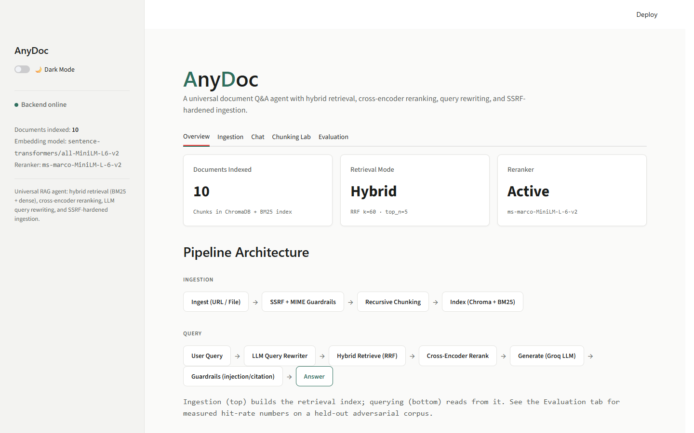
<p class="caption">Figure 18.1: Overview tab <span class="tag t-real">REAL</span>: chunk count, retrieval mode and reranker read from <code>GET /stats</code>.</p>

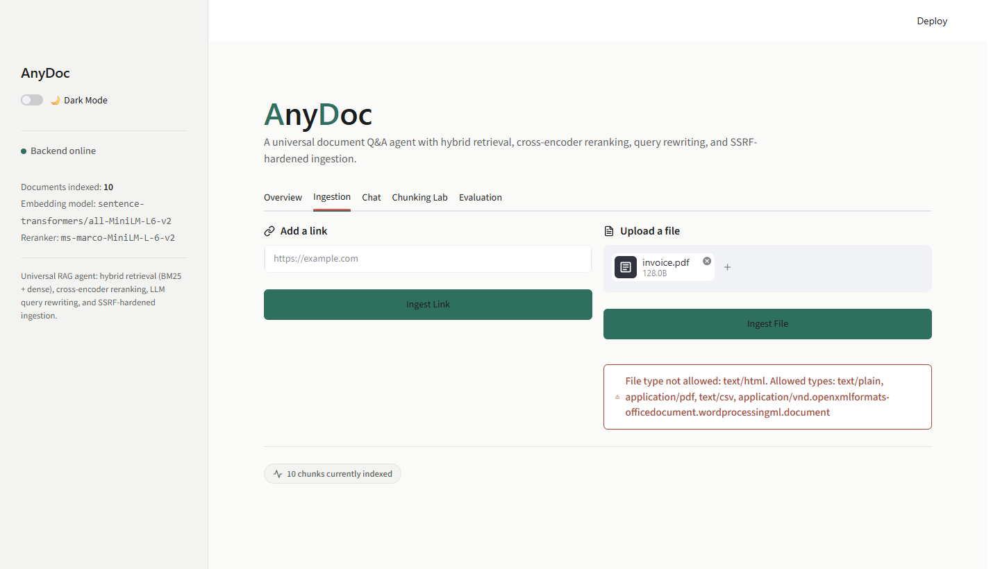
<p class="caption">Figure 18.2: Ingestion tab <span class="tag t-real">REAL</span>: <code>samples/invoice.pdf</code> (HTML renamed .pdf) rejected by the magic-byte check.</p>

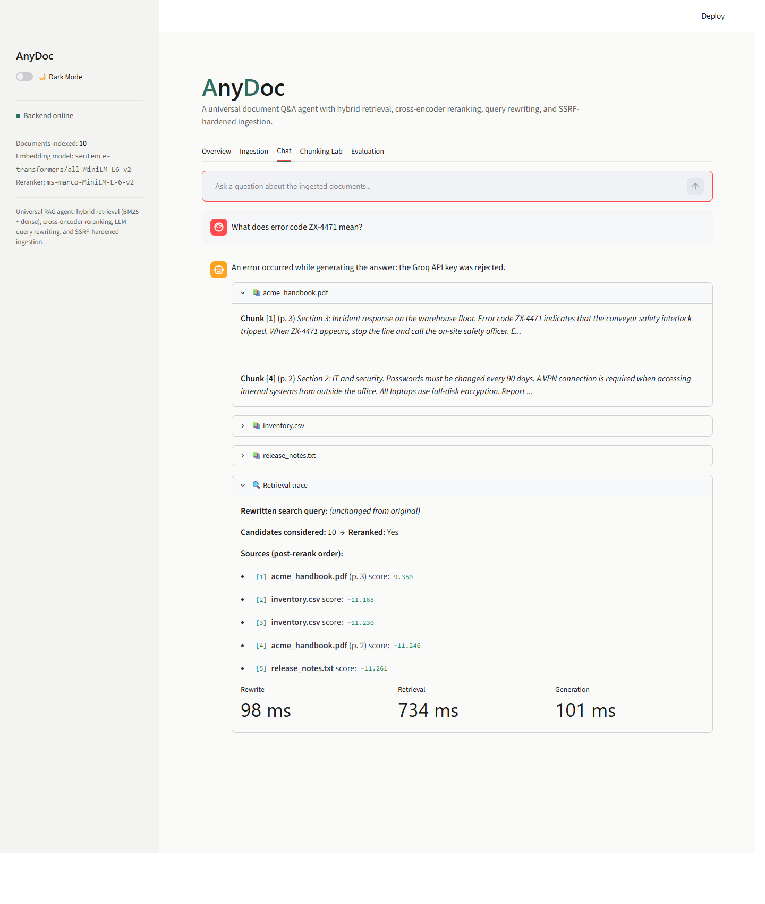
<p class="caption">Figure 18.3: Chat tab <span class="tag t-real">REAL</span>: the answer line shows the generation error path (offline key); the cited chunk (p. 3), rerank scores and timings are genuine.</p>

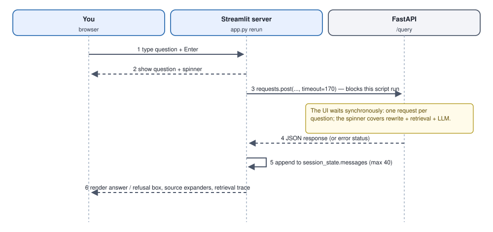
<p class="caption">Figure 18.4: The UI waits synchronously for the API.</p>

| UI behaviour | Implementation |
|---|---|
| Health dot, sidebar stats | `fetch_stats()`: `GET /stats`, cached 10 s, 45 s timeout (tolerates cold starts) |
| File upload | `st.file_uploader(type=["pdf","txt","csv","docx"])` → multipart `POST /ingest/file` |
| URL input | `st.text_input` → `POST /ingest/url` |
| Loading state | `st.spinner(...)` while the blocking `requests.post` runs |
| Success / error | `render_status`; `error_detail()` safely handles non-JSON error pages (e.g. proxy timeouts) |
| Answer | Markdown; refusals (prefixes "I cannot answer", "The generated answer", "I cannot fulfill") in a red box, HTML-escaped |
| Citations | Expanders per source file listing `Chunk [i] (p. N)` excerpts |
| Trace | Rewritten query, candidates, rerank scores, three timings |
| History | `st.session_state.messages`, capped at 40 messages per browser session |

**Synchronous behaviour.** Each Streamlit interaction re-runs the script; during `requests.post` that run
blocks until the API answers or the timeout expires. FastAPI's `/query` is also synchronous (a regular
`def`, executed in a thread pool). Only `/ingest/file` is `async` (to read the upload).

# 19. Configuration and Environment Variables {#ch19}

| Variable | Controls | Required | Read by | Placeholder | Secret | Render |
|---|---|---|---|---|---|---|
| `GROQ_API_KEY` | Access to the Groq LLM | **Yes** (API won't start without one; a wrong one makes every LLM step fail) | `ChatGroq` (env); `.env` loaded by `load_dotenv()` in `main.py` | `gsk_...` | **Yes** | Dashboard, `sync: false` |
| `API_URL` | Where the UI sends requests | No (default `http://localhost:8000`) | `app.py` | `http://api:8000` | No | Set in `render.yaml` |
| `PYTHONPATH` | Lets `import src...` work | Locally yes (`.`) | Python | `.` | No | Dockerfile sets `/app` |
| `PORT` | Listening port on Render | Render only | `dockerCommand` (`--port $PORT`) | — | No | Injected by Render |
| `PYTHONUNBUFFERED`, `OMP_NUM_THREADS`, `MKL_NUM_THREADS`, `TOKENIZERS_PARALLELISM` | Logging, thread pools (memory) | No | Dockerfile `ENV` | `1`, `1`, `1`, `false` | No | Image |
| `FASTEMBED_CACHE_PATH` | Where models are cached | No (default: system temp dir) | fastembed library | `/models` | No | Not set |
| `USER_AGENT` | Header for web fetching | No (a warning is printed if unset) | LangChain WebBaseLoader | `AnyDoc/1.0` | No | Not set |

Fixed in code (not configurable): `DB_DIR = "./chroma_db"`, `MAX_UPLOAD_MB = 10`, chunk 500/50, top_n 5,
RRF k 60, model names. `.env.example` contains only `GROQ_API_KEY=your_api_key_here`. `.env` is listed in both
`.gitignore` and `.dockerignore`, so the key never enters Git or an image layer. **Never commit a real
key:** a pushed secret can be scraped within minutes and stays in Git history even after deletion.

*Application configuration* (env vars above, constants in code) changes app behaviour. *Infrastructure
configuration* (`Dockerfile`, `docker-compose.yml`, `render.yaml`, `ci.yml`) decides where and how it runs.

# 20. Testing and Evaluation {#ch20}

**Test suite:** 50 tests, all passing in about 20 s (`pytest -q` with `PYTHONPATH=.` and a dummy
`GROQ_API_KEY`). They need no Groq access: every LLM is mocked or stubbed. Embedding and reranking tests use
the real models from the local cache.

| File | Tests | What they verify |
|---|---|---|
| `tests/test_api.py` | 9 | Through FastAPI: traversal-safe temp paths, idempotent re-ingest, 422 for text-free files, 400 for spoofed/unsupported files, oversized uploads, blank queries, page numbers in sources, SSRF rejection |
| `tests/test_guardrails.py` | 8 | SSRF (loopback, private, metadata, CGNAT, IPv6/multi-address, redirect to metadata), magic bytes, size, content↔extension |
| `tests/test_generation.py` | 8 | Injection and profanity regex (incl. false-positive regressions), citation check, metadata batching, refusals, LLM-error reasons |
| `tests/test_hybrid_search.py` | 6 | Model-consistency guard, hybrid retrieval, BM25 rebuild on insert, tokenizer, ID matching, idempotent upsert |
| `tests/test_ingestion.py` | 5 | Latin-1 TXT, UTF-8 BOM CSV, robots.txt redirect not followed, robots rules, HTTP error pages not ingested |
| `tests/test_query_rewriter.py` | 5 | Rewrite output, injection skip, error fallback, blank input, quote stripping |
| `tests/test_reranker.py` | 5 | Reordering by score, empty input, lazy loading, retriever integration, candidate pool = 15 |
| `tests/test_chunk_quality.py` | 3 | Both chunking strategies, quality report, strategy comparison |
| `tests/test_ui.py` | 1 | Chunking Lab renders (Streamlit `AppTest`) |

**Evaluation 1: the 105-document benchmark** (`src/evaluation/evaluator.py`, `eval_set.json`): 8 "needle"
facts among 97 distractors. Result <span class="tag t-real">REAL</span>: dense 8/8, hybrid 8/8, with every target ranked #1 by dense search.
**What it proves:** the hybrid pipeline is wired correctly and causes no regression on this set. **What it does
not prove:** that hybrid is better. The set saturates, and every query contains its needle ID verbatim.

**Evaluation 2: demo retrieval eval** (`src/evaluation/demo_retrieval_eval.py`, `samples/demo_eval_set.json`):
12 answerable + 3 no-answer questions over the 10 sample chunks, k = 5. <span class="tag t-real">REAL</span>:

| Mode | Hit@1 | Hit@3 | Hit@5 | MRR@5 |
|---|---|---|---|---|
| Dense only | 0.75 | 1.00 | 1.00 | 0.88 |
| BM25 only | 0.83 | 1.00 | 1.00 | 0.89 |
| Hybrid (RRF) | 0.83 | 1.00 | 1.00 | 0.92 |
| Hybrid + rerank | 1.00 | 1.00 | 1.00 | 1.00 |

*Hit@K* = fraction of questions whose correct chunk is in the top K. *MRR@5* = average of 1/rank of the first
correct chunk (0 if not in the top 5). On no-answer questions the top rerank score was −10.97 to −11.26, versus
at least −8.85 for answerable ones. That is a hint for a future "no answer" threshold, but 15 questions are far
too few to set one. **Not measured anywhere:** answer correctness, citation faithfulness, hallucination rate,
the rewriter's effect, latency percentiles, behaviour at scale.

**Passing tests vs a good demo vs production.** Tests prove specific behaviours under controlled inputs. A
demo proves the happy path works once. Production reliability needs load, real documents, monitoring,
security review and evaluation on real questions, none of which exist yet. <span class="tag t-prop">PROPOSED</span> next
metrics: Recall@k and nDCG on a few hundred labelled queries, answer exact-match/F1, citation-support rate,
p50/p95 latency, and a security regression suite.

# 21. Docker, GitHub Actions and CI {#ch21}

A **container** packages the app, its Python version and system libraries into one image that runs the same
everywhere. AnyDoc builds **one image** and runs it twice with different commands.

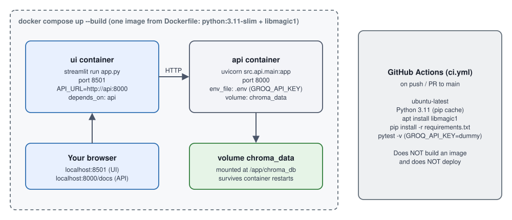
<p class="caption">Figure 21.1: <code>docker-compose.yml</code> services and the GitHub Actions workflow.</p>

| Item | Verified value |
|---|---|
| Base image | `python:3.11-slim` + `apt-get install libmagic1` (needed by python-magic on Linux) |
| Default command | `uvicorn src.api.main:app --host 0.0.0.0 --port 8000` |
| `api` service | port 8000, `env_file: .env`, volume `chroma_data:/app/chroma_db` |
| `ui` service | `streamlit run app.py --server.port 8501 --server.address 0.0.0.0`, `API_URL=http://api:8000`, `depends_on: api` |
| `.dockerignore` | excludes `venv/`, `.env`, `chroma_db/`, `.git/`, `tests/`, caches |
| Models | **not** baked in: downloaded on first start inside the container |

Commands (Docker was not running during the audit, so these are **not verified** here):

```bash
docker compose up --build        # build the image, start api + ui
docker compose ps                # list running services
docker compose logs -f api       # follow API logs
docker compose down              # stop (the chroma_data volume is kept)
```

**CI** (`.github/workflows/ci.yml`): on every push and pull request to `main`, Ubuntu + Python 3.11 (pip
cache), installs `libmagic1` and `requirements.txt`, runs `pytest -v` with `PYTHONPATH=.` and
`GROQ_API_KEY=dummy-ci-key`. **CI does not build a Docker image and does not deploy.** Render deploys on its own
when it sees a new commit (Ch. 22).

# 22. Deployment on Render: From Laptop to Public URL {#ch22}

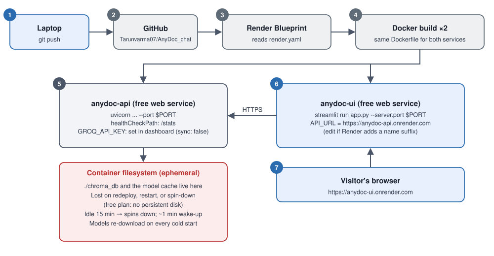
<p class="caption">Figure 22.1: The Render Blueprint in <code>render.yaml</code>: two free Docker web services from one repository.</p>

**How to read it:** steps 1–4 happen on every deploy. Services 5 and 6 run the same image with different
commands. The visitor only talks to the UI (7); the UI calls the API over public HTTPS. The red box is the
key limitation.

| # | Question | Answer for this repository |
|---|---|---|
| 1 | What goes to Git? | Code, tests, docs, samples, `.env.example`. **Not** `.env`, `venv/`, `chroma_db/` |
| 2 | What does Render read? | `render.yaml` (Blueprint) and the `Dockerfile` |
| 3 | Build command | No separate build command: Render runs `docker build` with the Dockerfile |
| 4 | Start command | `dockerCommand` per service (uvicorn / streamlit) |
| 5 | Port | Render injects `$PORT`; both commands listen on it. A hard-coded port would fail the health check |
| 6 | Env vars | `GROQ_API_KEY` entered in the dashboard (`sync: false`); `API_URL` set in the file |
| 7 | UI → API | `API_URL=https://anydoc-api.onrender.com`; must be edited if Render assigns another name |
| 8 | New deploy | Push to the connected branch → rebuild both images → replace the running containers |
| 9–10 | Logs; build vs runtime failure | Dashboard → service → *Logs*. A build failure stops at pip/apt output; a runtime failure shows a Python traceback after `uvicorn`/`streamlit` start |
| 11 | Health | `GET /stats` is the API's health check (`healthCheckPath: /stats`); there is no dedicated `/health` |
| 12 | Post-deploy test | `curl https://<api-host>/stats`, then upload a sample file and ask a question in the UI |

### Verified deployment state (read-only checks, 10 October 2026)

| Check | Result |
|---|---|
| `GET https://anydoc-api.onrender.com/stats` | **HTTP 200 after 51.6 s** (cold start); `document_count: 0`; model names as configured |
| `GET https://anydoc-ui.onrender.com/` | HTTP 200 after 22.4 s |
| `GET https://anydoc-ui.onrender.com/_stcore/health` | **HTTP 500** on two attempts: the UI's health is **unverified** |
| Deployed code version | Render builds from GitHub `main` (commit `ecfef6c`). The local branch is **2 commits ahead** (including the UI out-of-memory fix `befa3fc`), and all audit fixes are uncommitted, so the live services run older code |

### Persistence: mandatory to understand

| Storage type | Survives restart? | AnyDoc today |
|---|---|---|
| Container filesystem | **No.** Lost on redeploy, restart, or free-tier spin-down | Where `./chroma_db` and the model cache live on Render |
| Persistent disk | Yes | **Not available on Render free web services** (Render docs). Requires a paid instance and a `disk:` block |
| External database / storage | Yes, independent of the container | Not used (a hosted vector DB or pgvector would be the <span class="tag t-prop">PROPOSED</span> route) |
| Temporary runtime memory | No | The BM25 index (rebuilt from Chroma at startup) |

Render's free tier, per its documentation: services spin down after **15 minutes** without traffic and take
**about a minute** to wake; filesystem changes are lost on every redeploy, restart or spin-down; 750 free
instance-hours per workspace per month. The 51.6 s first response and `document_count: 0` observed above are
exactly this behaviour. **Ingested documents on the free deployment are temporary.**

### Deployment troubleshooting

| Symptom | Likely causes | Where to look | Safe diagnostic step |
|---|---|---|---|
| Build succeeds, app won't start | Import error, missing `GROQ_API_KEY` (ChatGroq requires one at startup) | Service logs (traceback) | Check the env var exists; reproduce with `docker compose up` locally |
| API up, UI shows "Backend offline" | Wrong `API_URL`, API asleep (cold start > 45 s) | UI logs; `curl <API_URL>/stats` | Correct `API_URL`, redeploy UI; wait and refresh |
| Health check fails | Not listening on `$PORT` / `0.0.0.0` | Deploy events | Confirm `dockerCommand` uses `$PORT` |
| Every answer "…API key was rejected" | Invalid or revoked key | API logs (`LLM Generation failed`) | Set a new key in the dashboard; redeploy |
| "…model is not available" | Groq retired the model | API logs | Update the model name in the three LLM classes |
| URL ingestion fails in production | Site blocks bots / robots.txt, JS-only page, DNS | API logs (`Skipping URL …`) | Try a simple static page |
| Out-of-memory restarts | Model loading; `/evaluate` (~350 MB) on 512 MB | Render metrics / events | Avoid `/evaluate` on free tier; upgrade plan |
| Documents disappear | Spin-down/restart wipes the container filesystem | `/stats` shows 0 | Expected on free tier; needs a disk or external DB |
| Works locally, fails deployed | Older code deployed, env differences, cold start timeouts | Compare commit in dashboard vs `git log` | Push the fixes; retry after warm-up |
| Deploy OK, requests error | Unhandled exception path | API logs | Reproduce the same request locally with curl |

# 23. Design Decisions: Why These Technologies? {#ch23}

"Documented" means the repository (README, DEPLOY.md, code comments) states the reason. "Rationale" is a
reasonable engineering interpretation, not a historical fact.

<div class="decisions" markdown="1">

| Decision | Problem solved | Trade-offs | Alternative offers | Switch when | Source |
|---|---|---|---|---|---|
| **FastAPI** vs Flask/Django | Typed request validation (automatic 422), OpenAPI docs | Sync routes share global singletons; no auth built in | Flask: simpler; Django: admin, ORM, auth | Need users/ORM/admin → Django | Rationale |
| **ChromaDB (embedded)** vs Postgres/pgvector or hosted DB | Zero-ops persistent vector store | Single process; no tenancy; lost on free Render | pgvector: SQL + backups; Qdrant/Pinecone: scale, filters | Multiple instances, tenants, or durable hosting | Rationale |
| **Dense** vs **BM25** | Meaning vs exact tokens | Dense blurs IDs; BM25 misses synonyms | — | — | Documented (README Phase 5) |
| **Hybrid** vs dense-only | Coverage of both failure modes | Two indexes; BM25 rebuild per ingest | Dense-only: simpler | Evaluation shows no gain on your data | Documented; benefit **not demonstrated** (8/8 vs 8/8) |
| **RRF** vs raw score sum | Merge incomparable scores without tuning | Ignores score margins | Weighted, normalised fusion | Labelled data available to tune weights | Documented |
| **Cross-encoder rerank** vs none | Precise final top 5 | ~15 model runs per query; first-query load | No rerank: faster | Latency budget tight; rerank shows no gain | Documented (README) |
| **Query rewriting** vs original | Adds keywords to vague questions | Extra LLM call; possible drift; unmeasured | HyDE, multi-query | Measurement shows no gain | Documented |
| **RAG** vs fine-tuning | Fresh, private, citable knowledge | Bounded by retrieval quality | Fine-tuning: style/format adaptation | Need behaviour change, not knowledge | Rationale |
| **Local embeddings (fastembed)** vs embedding API | No per-call cost, works offline after download, no PyTorch | Smaller model quality; CPU time in the API process | OpenAI/Cohere embeddings: higher quality | Quality matters more than cost | Documented (OOM on 512 MB) |
| **Docker** vs manual install | Same environment locally, in CI and on Render; libmagic included | Image size; models not baked in | Plain venv: quicker locally | — | Documented |
| **Groq Llama 3.1 8B** | Fast, cheap generation | Weaker reasoning than larger models | Larger hosted models | Answer quality insufficient | Rationale |

</div>

# 24. Performance and Resource Usage {#ch24}

<span class="tag t-real">REAL</span> measurements from `docs/guide_src/compute_examples.py` on the audit laptop (Windows 11, CPU only),
**warm models, 10-chunk corpus**, averaged over 10–20 runs. They show relative costs, not production latency.

| Operation | Time |
|---|---|
| Embed one question | 8.6 ms |
| Dense top-15 search (embed + Chroma) | 7.7 ms |
| BM25 score of all chunks | 0.1 ms |
| Hybrid retrieval, no rerank | 12.1 ms |
| Hybrid retrieval **with** rerank (10 candidates) | **309.4 ms** |
| Chunk the 4-page handbook | 0.2 ms |
| Embed + store its 4 chunks | 108.0 ms |

Other observations: the API started in ~9 s locally with cached models. A first query showed `retrieval_ms` of
6,200 ms (user's run: cross-encoder loading) and 734 ms in the audit run. The live Render API took 51.6 s to answer
after idling. The README documents peak memory of ~88 MB after imports, ~241 MB with the embedding model,
and ~364 MB with the reranker (**not re-measured** here). **LLM latency was not measured** (no live calls).

**Where time goes, and the levers:**

* **Reranking dominates retrieval** (~25× the hybrid search here). Fewer candidates (`candidate_n`) is faster
  but gives the reranker less to choose from.
* **Larger chunks** mean fewer, slower-to-score chunks and a longer prompt.
* **Ingestion** is dominated by the metadata LLM call (one per file) and embedding (~25 ms per chunk here).
* **BM25 rebuild** reads and re-tokenises every chunk on each ingest: O(corpus).
* **Concurrency:** sync endpoints run in a thread pool; ingestion blocks its request until done; rebuilds are
  serialised by a lock.

<span class="tag t-prop">PROPOSED</span> measurement plan: log per-stage timings to a file; run 100 representative questions against a
realistic corpus (≥ 10k chunks); report p50/p95 for rewrite, retrieval, rerank and generation; record peak RSS
during ingestion and `/evaluate`; repeat with `candidate_n` 5/10/15 and chunk sizes 300/500/800.

# 25. Limitations and Future Improvements {#ch25}

**Implemented and verified** (code + tests): PDF/DOCX/TXT/CSV ingestion with controlled errors; URL ingestion
with SSRF checks, validated redirects and robots.txt; magic-byte + extension validation; idempotent re-ingest;
hybrid BM25 + dense retrieval with RRF; cross-encoder reranking; page-numbered sources; regex guardrails;
citation-index check; Chroma persistence on local disk; Docker files; CI tests.

**Partially implemented or not fully validated:**

* Query rewriting, metadata extraction and answer generation: wired with fallbacks and mocked tests, but
  **output quality never measured live**.
* Prompt-injection defence: regex on the question only; retrieved text unscreened.
* Citation validation: identifiers only, not support.
* Web extraction: static HTML, nav/footer noise kept, depth-1 links.
* Docker Compose and the Render UI service: present, not verified working in this audit.
* Evaluation: two small sets; no answer-level metrics.

**Potential future improvements** <span class="tag t-prop">PROPOSED</span>, none of which exist today:

| Area | Improvement |
|---|---|
| Documents | OCR for scans; table-aware PDF parsing; heading-aware chunking; delete/update by source |
| CSV | Text-to-SQL or pandas tools for aggregate questions |
| Web | Boilerplate removal (e.g. trafilatura); headless rendering for JS sites; size limits |
| Reliability | Entailment-based citation checks; "no answer" threshold from rerank scores (needs data) |
| Security | IP pinning / egress proxy (DNS rebinding); screen retrieved chunks; auth + rate limits |
| Persistence | Render disk (paid) or an external vector DB |
| Errors | Return 502/503 for LLM failures instead of HTTP 200 |
| Observability | Structured logs, request IDs, metrics |
| Evaluation | Hundreds of labelled real questions; answer + citation metrics; CI regression gate |

# 26. Interview Preparation from the Actual Repository {#ch26}

Each answer: **Say** (spoken, short) · **Deeper** · **Code** · **Follow-up → honest answer**.

<div class="qa" markdown="1">

### Beginner

**Q1. What is AnyDoc?** · **Say:** A document Q&A service: upload files or a URL, ask questions, get answers grounded in those documents with numbered citations. · **Deeper:** FastAPI backend + Streamlit UI; hybrid BM25/vector retrieval, RRF, cross-encoder rerank, Groq LLM. · **Code:** `src/api/main.py`, `app.py` · **Follow-up:** Is it production-ready? → No: no auth, no persistent hosting storage, no answer-quality evaluation.

**Q2. What is RAG?** · **Say:** Retrieve relevant passages first, then have the LLM answer from them. · **Deeper:** Keeps knowledge outside the model, so it can be updated by re-indexing and cited. · **Code:** `query_documents` (retrieve → `generate_answer`) · **Follow-up:** Why not fine-tune? → Fine-tuning gives no citations and must be redone on every change.

**Q3. What is an embedding?** · **Say:** A list of numbers representing a text's meaning, so similar texts get nearby vectors. · **Deeper:** all-MiniLM-L6-v2, 384 dims, unit length; "dog playing outside" vs "puppy running outdoors" = 0.675 cosine (measured). · **Code:** `EmbedStore.__init__` · **Follow-up:** Same model as the LLM? → No; separate small model used only for search.

**Q4. What file types are supported?** · **Say:** PDF with a text layer, DOCX, TXT, CSV, and web URLs. · **Deeper:** Loader chosen by extension after magic-byte validation; CSV is one document per row. · **Code:** `FileReader.load` · **Follow-up:** Scanned PDF? → Rejected with 422; no OCR.

**Q5. What does the user see as evidence?** · **Say:** Numbered sources with file name, page and excerpt, plus a retrieval trace. · **Deeper:** `sources[i]` is exactly `Document [i+1]` in the prompt. · **Code:** `query_documents` sources loop · **Follow-up:** Does a citation prove the claim? → No (Q24).

### Intermediate

**Q6. Why chunk documents?** · **Say:** Small pieces retrieve precisely and fit the model's input. · **Deeper:** 500 characters, 50 overlap, recursive splitter. · **Code:** `Chunker` · **Follow-up:** Tokens or characters? → Characters (`length_function=len`).

**Q7. Does the splitter respect sentences?** · **Say:** Only partly. · **Deeper:** Separators are `\n\n`, `\n`, space, `""`; a long paragraph is cut at a space, so overlap preserves context. · **Code:** `RecursiveCharacterTextSplitter` · **Follow-up:** Better? → Sentence/heading-aware splitting, evaluated on retrieval metrics.

**Q8. Why BM25?** · **Say:** Exact tokens like error codes and SKUs, which embeddings can blur. · **Deeper:** BM25Okapi, k1 1.5, b 0.75; regex tokenizer keeps `zx-4471` whole. · **Code:** `HybridRetriever._tokenize` · **Follow-up:** Bug found? → Whitespace splitting kept "?" attached; fixed, BM25 MRR 0.68 → 0.89 on the demo set.

**Q9. How does RRF work?** · **Say:** Sum of 1/(60 + rank) across both lists. · **Deeper:** Uses positions, not scores; agreement between lists wins. · **Code:** `_rrf` · **Follow-up:** Why 60? → Conventional default; not tuned here.

**Q10. Why a cross-encoder after vector search?** · **Say:** It reads question and passage together, so it judges relevance more precisely. · **Deeper:** Too slow for the whole corpus, so it reranks 15 candidates to 5. · **Code:** `Reranker.rerank` · **Follow-up:** Evidence? → Demo set Hit@1: 0.83 (hybrid) → 1.00 (reranked), only 12 queries.

**Q11. What is query rewriting?** · **Say:** The LLM turns the question into a keyword-rich search query. · **Deeper:** Used for retrieval + rerank; the original goes to the prompt; falls back on errors. · **Code:** `QueryRewriter.rewrite` · **Follow-up:** Does it help? → Not measured.

**Q12. Which LLM, and with what settings?** · **Say:** Groq `llama-3.1-8b-instant`, temperature 0. · **Deeper:** Used for metadata, rewriting, answers. · **Code:** three `ChatGroq(...)` calls · **Follow-up:** If Groq retires it? → Every LLM step fails with "model is not available"; change the name in three classes.

### Architecture

**Q13. Trace a /query request.** · **Say:** Validate → rewrite → BM25 + dense → RRF → rerank → guardrails → LLM → citation check → JSON. · **Deeper:** See Ch. 17 table. · **Code:** `query_documents` · **Follow-up:** Where does time go? → Rerank in retrieval; the Groq call in generation.

**Q14. How do BM25 and Chroma stay in sync?** · **Say:** A callback rebuilds BM25 after every insert. · **Deeper:** Observer pattern; also rebuilt at startup; serialised with a lock; queries read one snapshot. · **Code:** `register_callback`, `rebuild_index` · **Follow-up:** Cost? → O(corpus) per ingest.

**Q15. What happens when the same file is uploaded twice?** · **Say:** Nothing new is added. · **Deeper:** IDs = sha256(source, chunk_index, text); Chroma upserts. · **Code:** `EmbedStore._chunk_id` · **Follow-up:** Changed file? → New chunks added, old ones stay (no delete-by-source).

**Q16. What is stored in Chroma?** · **Say:** Chunk text, its embedding, metadata, an ID. · **Deeper:** Not the original file; collection metadata pins the embedding model. · **Code:** `EmbedStore` · **Follow-up:** Similarity metric? → HNSW l2 on unit vectors, which ranks like cosine.

**Q17. How does the UI talk to the API?** · **Say:** HTTP via `requests` to `API_URL`. · **Deeper:** Synchronous with a spinner; 170 s timeout on query; no models in the UI process. · **Code:** `app.py` · **Follow-up:** Why separate? → The UI once ran out of memory loading a model; it now delegates everything.

### Security

**Q18. How does URL ingestion create an SSRF risk?** · **Say:** The server fetches the URL from inside its network, so it can reach internal services. · **Deeper:** Metadata endpoints, admin panels, localhost. · **Code:** `validate_url` · **Follow-up:** Example? → `http://169.254.169.254/latest/meta-data/` → 400.

**Q19. Why check every resolved address?** · **Say:** A host can have a public IPv4 and an internal IPv6 address. · **Deeper:** `getaddrinfo` returns all; any non-global address rejects. · **Code:** `resolve_all_addresses` · **Follow-up:** CGNAT? → `100.64.0.0/10` is not "private" in Python, so `is_global` is used.

**Q20. Why validate redirects?** · **Say:** A safe URL can redirect to an internal one. · **Deeper:** Manual redirect loop (max 5), each hop validated, robots.txt too. · **Code:** `resolve_safe_url` · **Follow-up:** Fully secure? → No: DNS rebinding remains.

**Q21. How are spoofed files handled?** · **Say:** Type comes from magic bytes, and must match the extension. · **Deeper:** HTML renamed .pdf → 400; PDF renamed .txt → 400. · **Code:** `validate_file` · **Follow-up:** Size limit? → 10 MB, read bounded.

**Q22. What does prompt-injection protection cover?** · **Say:** A regex on the user's question. · **Deeper:** Also skips metadata extraction on matching previews; retrieved chunks are not screened. · **Code:** `check_prompt_injection` · **Follow-up:** Bypass? → Rephrasing; indirect injection via documents.

### Reliability and critical thinking

**Q23. Why hybrid if dense already works?** · **Say:** Different failure modes; hybrid covers exact tokens. · **Deeper:** On the 105-doc benchmark both score 8/8, so no demonstrated gain there. · **Code:** `evaluator.py` · **Follow-up:** How would you prove it? → Larger labelled set with paraphrased, ID-free queries.

**Q24. What does citation validation guarantee?** · **Say:** Only that each [n] points to a supplied chunk. · **Deeper:** Not relevance, not support; uncited answers pass. · **Code:** `verify_citations` · **Follow-up:** Improve? → NLI entailment per sentence.

**Q25. How do you know BM25 improves results?** · **Say:** On this data I can't claim a general improvement. · **Deeper:** The demo set shows BM25 finds exact IDs; hybrid MRR 0.92 vs dense 0.88 on 12 queries. · **Code:** `demo_retrieval_eval.py` · **Follow-up:** Significance? → Far too few queries.

**Q26. Scanned PDF?** · **Say:** 422 with a clear message. · **Deeper:** pypdf finds no text layer. · **Code:** `require_extractable_text` · **Follow-up:** Add OCR? → Only if scans matter; adds heavy dependencies and latency.

**Q27. Web scraping vs crawling?** · **Say:** Scraping extracts one page's content; crawling discovers and follows many pages. · **Deeper:** AnyDoc scrapes one page plus ≤ 5 same-host links, depth 1. · **Code:** `LinkReader.load` · **Follow-up:** JS sites? → Not supported.

**Q28. What happens when ChromaDB restarts?** · **Say:** Locally the data persists in `./chroma_db`. · **Deeper:** On Render free it is wiped; BM25 is rebuilt from Chroma at startup. · **Code:** `persist_directory` · **Follow-up:** Fix? → Paid disk or an external DB.

**Q29. How would you debug high query latency?** · **Say:** Read the three timings in the trace first. · **Deeper:** retrieval_ms high → rerank / first-load; gen_ms high → Groq; rewrite_ms → Groq. · **Code:** `query_documents` timings · **Follow-up:** First query slow? → Lazy cross-encoder load.

**Q30. Why RRF instead of adding scores?** · **Say:** The scales are incomparable. · **Deeper:** BM25 is unbounded; vector distances aren't; RRF needs no normalisation. · **Code:** `_rrf` · **Follow-up:** Downside? → Ignores margins.

**Q31. What evidence supports retrieval quality?** · **Say:** Two small benchmarks and 50 tests. · **Deeper:** 8/8 on the saturating 105-doc set; demo set table. · **Code:** `src/evaluation/` · **Follow-up:** Answer quality? → Not measured.

### Deployment

**Q32. How is it deployed on Render?** · **Say:** A Blueprint builds the Dockerfile into two free web services. · **Deeper:** API uses `$PORT`, health check `/stats`; UI calls the API via `API_URL`. · **Code:** `render.yaml` · **Follow-up:** Is it live? → API responded (after 51.6 s); UI health returned 500; it runs older code.

**Q33. Where do secrets live?** · **Say:** `GROQ_API_KEY` in the environment: `.env` locally, the Render dashboard in production. · **Deeper:** Ignored by Git and Docker. · **Code:** `.gitignore`, `.dockerignore` · **Follow-up:** Missing key? → The API fails at startup.

**Q34. What does CI do?** · **Say:** Runs pytest on every push and PR to main. · **Deeper:** Ubuntu, Python 3.11, libmagic, dummy key. · **Code:** `ci.yml` · **Follow-up:** Does it deploy? → No.

**Q35. What would you change before production?** · **Say:** Auth, persistent storage, real evaluation, injection hardening. · **Deeper:** Plus DNS-rebinding fix, 5xx on LLM failure, monitoring, background ingestion. · **Code:** Ch. 25 · **Follow-up:** First priority? → Persistence and auth, then evaluation.

**Q36. Which module would you open to change chunk size?** · **Say:** `main.py`, where `Chunker(strategy="recursive")` is created, or the defaults in `chunk.py`. · **Deeper:** Changing it requires re-ingesting. · **Code:** `src/pipeline/chunk.py` · **Follow-up:** How to choose? → Sweep and measure (Ch. 7).

</div>

# 27. The Final Mental Model {#ch27}

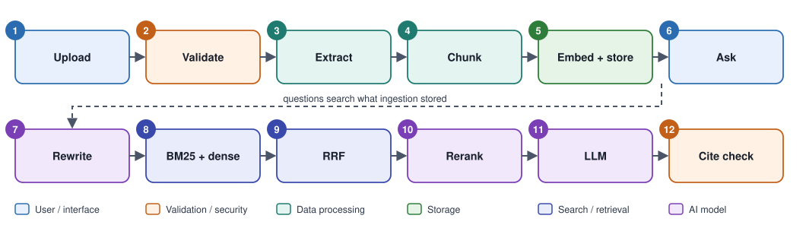{: style="width:88%"}
<p class="caption">Figure 27.1: Everything in twelve steps: ingestion on the top row, questions on the bottom row.</p>

**The whole project in under two minutes (plain English).** AnyDoc lets you ask questions about your own
documents. When you upload a file, it checks the file is what it claims to be, pulls out the text, cuts it
into small overlapping pieces, turns each piece into a list of numbers that captures its meaning, and saves
everything in a database. When you ask a question, it searches two ways at once: by exact words and by
meaning. It merges the two result lists, asks a careful second model to pick the five best pieces, and gives
only those to a language model with strict instructions to answer from them and cite them. Finally it checks
the citations point at real pieces and shows you the answer with its sources.

**For an AI engineer.** FastAPI service with module-level singletons. Ingestion: libmagic + extension
validation, SSRF-validated fetching with manual redirects, LangChain loaders, one Groq metadata call per
file, recursive 500/50 character chunking, fastembed all-MiniLM-L6-v2 (384-d, normalised) into a persistent
Chroma collection with deterministic upsert IDs, and an observer-rebuilt in-memory BM25Okapi index.
Query: LLM rewrite with fallbacks, dense top-15 and BM25 top-15, RRF k=60, ms-marco MiniLM cross-encoder to
top 5, regex input guardrails, Llama 3.1 8B at temperature 0, citation-index verification, and per-stage
wall-clock timings. Evaluated only on small retrieval sets; generation quality is unmeasured.

| 30-second explanation | Script |
|---|---|
| **RAG** | Instead of trusting what the model memorised, we look up the relevant passages first and make the model answer from them, with citations. New knowledge means re-indexing, not retraining. |
| **Hybrid retrieval** | Keyword search catches exact codes and names; vector search catches paraphrases. We run both and merge, so either kind of question finds its evidence. |
| **BM25 + RRF** | BM25 ranks documents by shared rare words, adjusted for repetition and length. RRF merges two rankings by adding 1/(60 + rank) from each, using positions rather than incomparable scores. |
| **Chunking + embeddings** | We cut documents into 500-character overlapping pieces, then turn each into 384 numbers so similar meanings sit close together, and search by closeness. |
| **SSRF protection** | Before fetching a URL, we resolve every address it points to and refuse anything internal, re-checking at every redirect, so users can't make our server reach private networks. DNS rebinding is the known gap. |
| **Render deployment** | A Blueprint builds the Docker image into an API service and a UI service on free instances, wired by `API_URL`. Free instances sleep and have no persistent disk, so the index is temporary. |

### Explain these without looking

<div class="checklist" markdown="1">

- [ ] The two phases and what each stores or reads
- [ ] Why chunk sizes are characters, and what overlap preserved in the real example
- [ ] 384 dimensions, unit length, why L2 ranks like cosine
- [ ] BM25's three ingredients and the tokenizer bug
- [ ] The RRF formula with a worked number
- [ ] Bi-encoder vs cross-encoder and why 15 → 5
- [ ] Which question (original or rewritten) goes where
- [ ] Exactly what `verify_citations` checks, and what it doesn't
- [ ] Every SSRF check, plus DNS rebinding
- [ ] The five endpoints, their bodies and status codes
- [ ] The three timing fields
- [ ] Why the Render deployment loses data, and what would fix it
- [ ] What the benchmarks prove and don't prove

</div>

# Appendix A: Evidence: Verified Facts and Uncertainties {#appA}

### Verified facts (read in code, measured, or observed during the audit)

* 5 FastAPI routes: `GET /stats`, `POST /ingest/file`, `POST /ingest/url`, `POST /query`, `POST /evaluate`.
* Loaders: PyPDFLoader (pypdf), Docx2txtLoader (docx2txt), TextLoader / CSVLoader with UTF-8 → Latin-1, WebBaseLoader (requests + BeautifulSoup, `html.parser`).
* Validation: 10 MB limit; libmagic MIME allowlist of 4 types; MIME↔extension map; SSRF on every resolved address; ≤ 5 validated redirect hops; validated robots.txt.
* Chunking: `RecursiveCharacterTextSplitter(500, 50, len)`, separators `\n\n`, `\n`, space, `""`.
* Embeddings: fastembed `sentence-transformers/all-MiniLM-L6-v2`, 384 dims, norm 1.0 (measured).
* Chroma: collection `qa_chatbot`, persist `./chroma_db`, HNSW space `l2` (read from collection config), sha256 IDs, upsert.
* BM25: `rank_bm25.BM25Okapi(k1=1.5, b=0.75)`, regex tokenizer; rebuilt on startup and on every insert.
* Retrieval: candidate_n 15, RRF k 60, top_n 5; reranker `Xenova/ms-marco-MiniLM-L-6-v2`, lazy.
* LLM: Groq `llama-3.1-8b-instant`, temperature 0, used by MetadataExtractor, QueryRewriter, QAGenerator.
* Tests: 50 passed. Benchmarks: 8/8 and 8/8; demo-set table in Ch. 20.
* Render: `render.yaml` with two free Docker services; live API returned 200 after 51.6 s with 0 documents; UI health returned 500; Render docs confirm no persistent disk on free services.

### Uncertainties (not verified)

* Live LLM behaviour: rewrite quality, answer quality, refusal compliance, injection resistance (no live calls were made).
* Whether `llama-3.1-8b-instant` is still offered by Groq today.
* Docker Compose end-to-end (Docker Desktop was not running).
* Whether the live UI service works (health endpoint returned 500); the exact commit Render deployed (inferred from GitHub `main`).
* Peak memory figures (taken from the README, not re-measured).
* Why each technology was originally chosen, where the repository does not say.

### Reproduce this guide

```bash
python docs/guide_src/compute_examples.py      # real scores, records, timings  (project venv)
python docs/guide_src/capture_screenshots.py   # real UI screenshots (offline key)
python docs/guide_src/diagrams.py              # SVG diagrams
python docs/guide_src/build_guide.py           # Markdown -> HTML -> PDF (Chrome)
```
